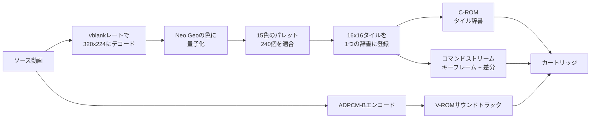
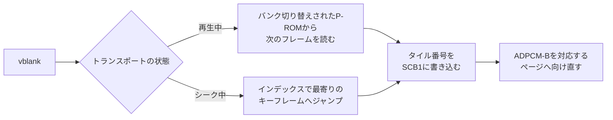

<div align="center">

# Neo Geo Media Player

<strong>改造なしのNeo Geo AESで動く音声付きのフルスクリーン映像と、<br>
それを自作ゲームに組み込むライブラリです。</strong>

[English](README.md) | 日本語 | [简体中文](README.zh-Hans.md) | [繁體中文（香港）](README.zh-HK.md)

[](https://github.com/gufranco/neogeo-media-player/actions/workflows/ci.yml)
[](RELEASES.md)
[](LICENSE)
[](#ハードウェアの上限)
[](#検証)

</div>

<p align="center">
  <a href="#クイックスタート"><strong>クイックスタート</strong></a> |
  <a href="#仕組み"><strong>仕組み</strong></a> |
  <a href="#品質"><strong>品質</strong></a> |
  <a href="#検証"><strong>検証</strong></a> |
  <a href="#ファミリー"><strong>ファミリー</strong></a>
</p>

<div align="center">


<sub>Sintelの予告編の6秒間です。ビルドしたカートリッジをコンソール本来の320x224で実行するMAMEからキャプチャしたもので、映像の開始とともに再生位置バーが表示されています。同じ映像がMaster SystemとGame GearのプレイヤーのREADMEの冒頭にもあります。SintelはBlender Foundationによる作品で、CC BY 3.0です。</sub>

</div>

```bash
uv --project tools run python -m neogeomedia.cartridge ~/Movies/my-film.mkv
# build/neogeomedia.neo
```

---

## 概要

**カートリッジメーカー。** 動画ファイルを指定すると、それを再生するNeo Geoカートリッジをビルドします。トランスポート、字幕、音声付きです。[クイックスタート](#クイックスタート)から始めてください。

**自作ゲーム向けのライブラリ。** 同じレンダラーを、ホームブリュー開発者が開発中のゲームにカットシーンを組み込めるようパッケージ化したものです。1回のブロッキング呼び出しが映像の再生中は画面を占有し、終了後にすべてのレジスタを返します。[自作ゲームに映像を組み込む](#自作ゲームに映像を組み込む)から始めてください。

カートリッジはライブラリと並べて作られているのではなく、ライブラリの上に構築されています。そのため、一方を壊すものはもう一方も壊します。

### 課題

Neo Geoにはビデオデコーダーも、フレームバッファも、スケーラーもありません。描画できるのはハードウェアスプライトだけです。デコードした画像を置く場所も、デコードする手段もありません。68000は12 MHzで動作し、サウンドチップがその下でストリーミングを続ける間、毎秒59.2フレームを維持しなければなりません。

残差もありません。コーデックは通常、予測の誤りを、すでに画面にある内容に差分を加えることで修正します。フレームバッファがなければ、加える対象がありません。修正としてできるのは、すでに存在するいずれかのタイルをスロットに指し示させることだけです。

### 解決策

コンソール上では何もデコードしません。オフラインのベイカーが動画をカートリッジのROMイメージに変換し、カートリッジ上のプレイヤーが事前に計算されたタイル番号をvblankごとに1回、スプライトコントロールブロックに書き込みます。

画面は横20、縦14のスプライトタイルからなる固定グリッドで、16x16ピクセルの280スロットが320x224のラスターを覆います。映像に必要な個別のタイルはすべて、キャラクターROM内のグローバル辞書に1回だけ登録されます。フレームは割り当てのリストで、たとえば「スロット137はタイル90412を表示する」といったものです。タイル番号がデコード済みの形式そのものなので、展開処理はありません。

<table>
<tr>
<td width="50%" valign="top">

#### 実行時のデコードはゼロ

プレイヤーはSCB1にタイル番号を書き込むだけで、それ以外は何もしません。何も変化しないフレームのコストは2バイトです。

</td>
<td width="50%" valign="top">

#### 実測による品質ラダー

35段です。段はテーブルと照合して見積もるのではなく、ソースを実際にベイクして決定します。

</td>
</tr>
<tr>
<td width="50%" valign="top">

#### シーンごとに再適合するパレット

240のCRAMバンクをエポックごとに再適合し、1エポックが続く数百フレームにわたってダブルバッファリングします。タイル数が1.5%増える代わりに、誤差が約6%減ります。

</td>
<td width="50%" valign="top">

#### geolithとビット単位で一致

カートリッジ自身のバイトから再構成したフレームは、エミュレーターが描画したものとピクセル単位で一致し、誤差は0.0000です。

</td>
</tr>
<tr>
<td width="50%" valign="top">

#### 命令単位で検査するタイミング

ビルドのたびにプレイヤーを逆アセンブルし、VRAMへの書き込みペアの間隔が文書化されたサイクルの最小値を下回ると失敗します。

</td>
<td width="50%" valign="top">

#### 動作するトランスポート

再生、一時停止、2x、5x、10xの早送り、巻き戻し、シークに対応し、ジャンプのたびに音声を対応するADPCMページへ向け直します。

</td>
</tr>
</table>

### 現状

前処理、エンコーダー、品質ラダー、ROMコンテナ、68000プレイヤー、トランスポートまで、全工程が動作します。

| 構成要素 | 状態 |
|---|---|
| エンコーダーと品質ラダー | 動作します。35段あり、表と照らし合わせるのではなく映像を実際にベイクして決めます |
| 映像 | 320x224、ラスター全体です。形の異なるソースは全体を埋めるようにクロップします |
| 68000プレイヤー | 動作します。ビルドゲートが逆アセンブルし、文書化された最小値を下回るVRAM書き込みペアがあれば失敗します |
| サウンド | YM2610のADPCM-B、最大55,555 Hzです。`--silent`で省けます |
| 字幕 | `--subtitles`で指定したSubRipの`.srt`、または同じ名前でソースの隣にあるものを、FIXレイヤーに最大40桁2行で描きます。下でオフとオンを切り替えます |
| 操作 | [実行方法](#実行方法)にあるトランスポートです。再生、一時停止、早送り、巻き戻し、シーク、ミュート、字幕、停止、診断があり、いずれかのボタンを押すとメニューが3秒間出ます |
| フィールドレート | どのボードでも59.185 Hzなので、どの地域でもカートリッジは同じ速さで再生されます |
| 回帰セット | 種類の異なる6本のクリップを、テスト実行のたびにベイクします |
| 実機での実行 | NeoSDから実機のAESとMVSで実行済みです。2026-10-17には[AGENTS.md](AGENTS.md)に記載した変更を含めて再び実行し、不具合は見られませんでした |

## すべてのプレイヤーが備える機能

2つのプレイヤーは[FAMILY.md](FAMILY.md)で定めた同じ機能リストに沿って作られており、この表は両方のREADMEで同じです。「予定」はまだ実装していない作業を表します。コンソールが搭載できない機能には、ハードウェア上の理由とともに「対応不可」と記載します。

| 機能 | Neo Geo | Master System | Game Gear |
|---|---|---|---|
| 動画ファイルからカートリッジまで1コマンドで作成 | はい | はい | はい。`--target gg` |
| 映像が画面全体を埋める。全体を覆うように拡大縮小してクロップ | はい | はい | はい。160×144の画面全体 |
| ソースに焼き込まれた黒帯を検出してクロップ | はい | はい | はい |
| 収まるまで映像と音声を最高品質から段階的に下げる | はい。`--quality search`が35段のラダーを下へ順にベイクし、音声は収まる範囲で最も高いレートを選びます | はい。カートリッジからはみ出すベイクは同じ探索でフレームレートを段階的に下げ、音声は最後に省きます | はい。Master Systemと同じ探索 |
| 追加ハードウェアなしで最大の標準カートリッジ | はい。128 MiBのキャラクターROM | はい。1 MB。Segaのマッパーのどの版でも扱える上限です | はい。1 MB。同じマッパー |
| 順序付きディザリング | はい。`--dither`、デフォルトで無効 | はい。`--dither`、デフォルトで有効 | はい。`--dither`、デフォルトで有効 |
| 映像の変化に合わせたパレットの再適合 | はい。シーンごと | はい。フレームごとで、収まる間は維持します | はい。フレームごとに4096色から |
| 追加ハードウェアなしのサウンド | はい。YM2610のADPCM-B | はい。PSGでのトーン合成 | はい。PSGでのトーン合成で、ステレオのソースからヘッドホンの左右へ振り分けます |
| サウンドの領域を映像に回す無音ビルド | はい。`--silent`。サウンドは専用のROMにあるため、省いても映像の領域は空きません | はい。`--silent` | はい。`--silent` |
| SubRipファイルからの字幕 | はい | はい。映像に焼き込むため、オフにはできません | はい。映像に焼き込むため、オフにはできません |
| 再生と一時停止 | はい | はい。本体のポーズボタン、ゲームギアではスタートボタン | はい。スタートボタン |
| 早送りと巻き戻し | はい。早送りは2x、5x、10x | 不可能。1フレーム分の転送だけで1フィールドの59,736 Tステートのうち最大54,000を使うため、リプレイは2フレーム分を送れません。代わりに左右でシーク地点へ移動します | 不可能。Master Systemと同じ理由で、1フレームの転送が1フィールドの59,736 Tステートのうち最大54,000を使います |
| シーク | はい。CとDで10秒間隔の地点へ移動。`--seek-every`で変更可能 | はい。左右で10秒間隔の地点へ移動。`--seek-every`で変更可能 | はい。左右で10秒間隔の地点へ移動。`--seek-every`で変更可能 |
| 経過時間と総時間を表示する再生位置バー | はい。いずれかのボタンを押してから3秒間 | はい。いずれかのボタンを押してから3秒間と、一時停止中 | はい。いずれかのボタンを押してから3秒間と、一時停止中 |
| 最初からの再生と停止 | はい | はい | はい |
| サウンドのオン、オフ | はい | はい、上 | はい、上 |
| 終了時に映像をループ | はい | はい | はい |
| 診断オーバーレイ | はい。Select | はい。下 | はい。下 |
| 破損したストリームのエラー画面 | はい | はい | はい |
| 自作ゲームへの映像の組み込み | はい。`--bundle`がそのまま組み込めるライブラリを出力します | はい。`--bundle`がそのまま組み込めるライブラリを出力し、`examples/cutscene`がそれでゲームをビルドします | はい。`--bundle`と`--target gg`でGame Gear用のライブラリを出力します |
| コンソールが描画する内容のプレビュー | はい。動画、またはソースと並べた4フレーム | はい。動画、またはソースと並べた4フレーム | はい。動画、またはソースと並べた4フレーム |
| 全ビルドでの書き込みタイミングゲート | はい | はい | はい |
| テスト実行ごとにベイクする回帰用の映像セット | はい。6本の映像 | はい。6本の映像 | はい。同じ6本をGame Gearの表示範囲にベイクします |
| 実機での動作 | はい。AESとMVS | はい。Master SystemとGame Gear | 予定。Master SystemのカートリッジはGame Gearで動作済みですが、ネイティブ版はまだです |

## 仕組み



実行時には、プレイヤーが次のフレームのコマンドを読み取り、スプライトコントロールブロック1へ直接書き込みます。



24 fpsのソースを59.185 Hzのラスターで表示すると、各フレームは約2.47回繰り返され、繰り返しにはコストがかかりません。10分間で、リファレンスストリームのスロット更新数はフレームあたり280スロット中平均24.6です。

キーフレームは280スロットすべてを書き換え、シーク先として機能します。トランスポートは、インデックスで最寄りのキーフレームを探し、そこから再生し直すことで任意の位置へジャンプします。10分の映像には913個のキーフレームが含まれます。

### すべてを決める制約

このプレイヤーとMaster SystemおよびGame Gearの[`smsgg-media-player`](https://github.com/gufranco/smsgg-media-player)は同じファミリーのメンバーであり、2つのマシンは設計が依存するただ1つの次元で異なります。

Neo Geoは**キャラクターROMに1,048,576個のタイルを常駐**させているので、プレイヤーはスプライトコントロールブロックにタイル番号を書き込むだけで、実行時にはそれ以外何もしません。Master SystemとGame Gearが扱えるのは16 KBのVRAMにある512パターンだけなので、そのプレイヤーは再生しながら映像のパターンをページングする必要があります。

| | Neo Geo | Master SystemとGame Gear |
|---|---|---|
| 支配的な制約 | キャラクターROM | カートリッジのバイト数 |
| フレームごとの作業 | タイル番号を書き込む | パターンをアップロードし、ネームテーブルのエントリを書き込む |
| 新しい構成要素 | なし | 何を追い出すかを決めるワーキングセットの方針 |

画質とは辞書の豊かさであり、辞書の豊かさとはキャラクターROMです。この事実が、以下のすべての設計判断を形作っています。

### 映像は画面全体を使う

320x224のすべてのピクセルを使い、枠はありません。形の異なるソースはラスター全体を覆うまで拡大縮小してからクロップするので、16:9の映像は幅の約5分の1を失い、コンソールが描くすべてのピクセルが映像になります。黒帯も他と同じタイルとして辞書に登録され毎フレーム描かれるため、黒帯を付けるオプションはありません。

### サウンド

サウンドはYM2610のADPCM-Bで、専用のボイスROMからストリーム再生します。映像が十分に短ければ、ベイカーはサウンドトラックをチップの上限である55,555 Hzでエンコードします。長い映像には、最後のサンプルが16 MiBのボイスROMのアドレス指定可能なページに収まる最も高いレートが使われ、上限のレートでは約10分になります。プレイヤーはフレーム0の後にストリームを開始し、シーク、巻き戻し、早送りのたびに対応するページへ向け直します。`--silent`でサウンドを省けますが、サウンドは専用のROMにあるため、映像の領域は増えません。

### 先行事例

- **Nintendo 64版バイオハザード2。** Angel Studiosは、映像用ハードウェアなしにソフトウェアでデコードする15分の映像を24 MiBの予算に収めました。色差のサブサンプリングは、共有のOklab指標における色差の重みとしてファミリーが受け継いでいる手法です。[Angel Studiosのポストモーテム](https://www.gamedeveloper.com/programming/postmortem-angel-studios-i-resident-evil-2-i-n64-version-)
- **RoQ**。The 11th HourとQuake IIIで使われた、フレームごとのコードブックを256エントリに制限するベクトル量子化器で、フレームごとに入る新しい断片の数が限られます。これは、フレームごとに上限のあるベイカーのタイル辞書と同じ形です。[MultimediaWiki](https://wiki.multimedia.cx/index.php/RoQ)
- **HPMANによるNeo Geo版Bad Apple**。320x224、13,167フレーム、約4分を約3 MBに収めています。1ビット1パレットなのでタイルの重複排除には最良のケースですが、同期した音声付きのタイルストリーム映像が実機で動くことを示しています。[yAronet](https://www.yaronet.com/topics/188010-bad-apple-demo-datlibdatimageneosoundbuilder)

## ハードウェアの上限

ここにある値はすべて、文章ではなく、互いに独立した2つのエミュレーターのソースコードから読み取ったものです。

| リソース | 上限 | 影響 |
|---|---|---|
| キャラクターROM | 20ビットのタイル番号、1,048,576タイル、128 MiB | どの品質の段でも制約となる要因です |
| プログラムROM | 3ビットのバンクラッチ、1 MiBのバンク8個 | コマンドストリームです。リファレンスのベイクは5バンクにわたって4.5 MBを使います |
| ADPCM-BボイスROM | 16ビットのページカウンター経由で4ビットサンプル16 MiB | チップ上限の55.6 kHzで約10分です。それより長いソースには、アドレス指定可能なページで終わる最高のレートを使います |
| スキャンラインあたりのスプライト | 96 | グリッドは20を使います |
| パレット | 16色のバンク256個、インデックス0は透明 | 240を映像用、16をメニュー用に予約しています |
| ウォッチドッグ | 約0.13秒 | 初期化ループの長さを制限します |
| ラスター | 6 MHzのドットクロックで横384、縦264、59.185 Hz | すべての地域で同じです |

> [!IMPORTANT]
> キャラクターROMのバンク切り替えはなく、あり得ません。geolithもMAMEもどのボードでも実装しておらず、計算上も不可能です。128バイトのタイル2^20個は、タイル番号がアドレス指定する128 MiBにちょうど等しくなります。128 MiBはウィンドウではなく、絶対的な上限です。

リフレッシュレートが設計全体を支えています。プレイヤーはvblankごとに映像を1フレーム進め、サウンドトラックはフレーム数に合わせて進むため、異なるレートでリフレッシュするコンソールでは映像が遅く再生され、音声がずれていきます。geolithは`LSPC_SCANLINES`を地域による違いなしに264に固定しており、地域設定が影響するのはラスターではなくBIOSジャンパーとCDドライブです。ここでビルドしたカートリッジは、日本、アメリカ、アジア、ヨーロッパのどのボードでも同じレートで再生されます。

## クイックスタート

ffmpegで読み込める動画ファイルなら何でも使えます。特定のフォルダーに置いたり、特定の名前を付けたりする必要はありません。

### 前提条件

| ツール | バージョン | インストール |
|:-----|:--------|:--------|
| Python | 3.14、[`.python-version`](.python-version)からuvが取得 | |
| uv | 最新 | [docs.astral.sh/uv](https://docs.astral.sh/uv/) |
| ffmpegとffprobe | 最近のもの | [ffmpeg.org](https://ffmpeg.org) |
| Docker | 最近のもの | [docs.docker.com](https://docs.docker.com/get-docker/) |
| Neo Geo BIOS | 任意 | エミュレーターの実行にのみ必要で、ビルドには不要です |

### コードの取得

ベイカーはデコード、色、映像、キャプチャのコードを[fmv-core-python](https://github.com/gufranco/fmv-core-python)サブモジュールを通じてMaster SystemとGame Gearのプレイヤーと共有しているため、サブモジュールごとクローンしてください。ダウンロードボタンのソースアーカイブにはサブモジュールが含まれないため、動作しません。

```bash
git clone --recurse-submodules https://github.com/gufranco/neogeo-media-player.git
git submodule update --init   # in a clone made without the flag
```

### カートリッジの作成

```bash
uv --project tools run python -m neogeomedia.cartridge ~/Movies/my-film.mkv
```

これでソースを計測し、カートリッジに収まる最高品質の段を決定し、ベイクしてROMをビルドし、`build/`に`.neo`を出力します。字幕は`--subtitles ~/Movies/my-film.srt`で追加できます。フラグを省略した場合は、ソースの隣に同じ名前で置かれた`.srt`が自動的に読み込まれます。

| ステップ | 内容 | 目安 |
|:-----|:-------------|:--------|
| キャリブレーション | 短い区間を24か所サンプリングし、コンテンツのタイル数でのコストを計測します | 1分未満 |
| 選択 | ラダー全体を表示し、収まる最良の段を決定します | 即時 |
| ベイク | 量子化、パレットの適合、全タイルの登録、音声のエンコードを行います | 10分のソースで約8分 |
| ビルド | プレイヤーをコンパイルし、ROMイメージをパックします | 数分 |

#### 生成されるもの

| パス | 内容 |
|:-----|:-----------|
| `build/neogeomedia.neo` | カートリッジです。NeoSDやエミュレーターが読み込むのはこのファイルです |
| `build/neogeomedia.zip` | 同じROMをMAMEのソフトウェアリスト用アーカイブにしたものです |
| `build/mame-hash/neogeo.xml` | MAMEがそのアーカイブを見つけるために必要なソフトウェアリストのエントリーです |
| `build/baked/` | 中間ROMイメージです。再ベイクせずにROMをビルドし直せるよう保持します |
| `build/report.json` | ベイクの数値です。フィルムが拒否された場合も書き出されます |
| `build/preview.mp4` | `--preview`を指定した場合のみ生成されます |

#### よく使うフラグ

| フラグ | 用途 |
|:-----|:----|
| `--subtitles PATH` | SubRipの`.srt`です。デフォルトはソースの隣にあるものです |
| `--quality search` | デフォルトです。`q01`から下へ順にベイクして収まるものを探し、結果を記憶します |
| `--quality q17` | 段を指定し、計測を省きます |
| `--denoise 1` | ノイズ除去の強さです。既定の探索では映像で計測し、段を指定した場合も`auto`で計測します |
| `--start 90 --duration 300` | ファイル全体ではなく、1:30から5分間を使います |
| `--preview out.mp4` | カートリッジの表示内容も描画し、目視で確認できるようにします。`.png`にすると、4つのフレームをソースと並べて保存します |
| `--silent` | サウンドを入れません。サウンドは専用のROMにあるため、映像に回る容量は増えません |
| `--seek-every 10` | CとDで移動するシークポイントの間隔を秒で指定します。1フレーム以上です |
| `--dither 0.5` | 0から1までの組織的ディザの強さです。既定値は0で、ディザなしです |
| `--bundle DIR` | プレーヤーライブラリとこのフィルムをそのまま組み込めるコピーとして書き出すフォルダです |
| `--bake-only` | ROMのビルドの前で停止します |
| `--build-dir DIR` | すべての出力を`build/`以外の場所に置きます |

### 実行方法

実機では、`build/neogeomedia.neo`をNeoSDフラッシュカートにコピーし、他のタイトルと同様に読み込みます。

映像は自動で再生を始めます。操作パネルはボタンを押すと表示され、数秒後に画面から消えます。

| ボタン | 動作 |
|:-------|:-------------|
| A | 一時停止と再生 |
| B | 通常速度で再生 |
| 右 | 早送り。2倍、5倍、10倍の順 |
| 左 | 巻き戻し |
| C、D | 前後のシークポイントへ移動します。間隔は既定で10秒です。ポイントから2秒以内なら、Cはその前のポイントへ戻ります |
| 上 | サウンドのオンとオフ |
| 下 | 字幕のオンとオフ |
| Start | 黒い画面で停止します。その後Start、A、Bのいずれかで最初から再生します |
| Select | 診断オーバーレイ |

ストリームが破損している場合は、乱れた映像を描かずに赤い画面で停止します。

MAMEでは、ビルドが書き出したアーカイブとハッシュファイルを指定し、BIOSディレクトリをROMパスに含めます。

```bash
mame aes -bios unibios23 -cart neogeomedia \
    -rompath build:/path/to/bios -hashpath build/mame-hash
```

[`verify_mame.sh`](tools/scripts/verify_mame.sh)はその準備を行ったうえで、MAMEが描画したものとベイカー自身のレンダリングを比較します。

libretroフロントエンドでは、geolithコアで`build/neogeomedia.neo`を読み込み、320列すべてを表示するために`geolith_overscan_*`を0に設定します。

### ツールチェーン

ROMのビルドはすべてDockerを通り、ホストのツールチェーンを使う経路はありません。[`build-in-docker.sh`](toolchain/build-in-docker.sh)は、ホストのパス上に`m68k-neogeo-elf`ツールチェーンがあっても、呼び出したユーザーとしてツールチェーンイメージ内で自身を実行します。[`Dockerfile`](Dockerfile)はそのイメージを固定しています。Ubuntuはダイジェストで、すべてのパッケージは日付付きのスナップショットから正確なバージョンで、3つのngdevkitパッケージは正確なバージョンとSHA-256で固定し、[`toolchain/ngdevkit.sha256`](toolchain/ngdevkit.sha256)に記載しています。ngdevkitのPPAはamd64版のみを公開しているため、イメージはどこでもamd64で、Apple SiliconではDockerがそれをエミュレートします。今日のビルドと来年のビルドは同じROMを生成します。

### 自作ゲームに映像を組み込む

レンダラーはライブラリであり、ベイカーはそれをngdevkitプロジェクトに配置できるフォルダーとして出力します。すべてソースとして提供されます。

```bash
uv --project tools run python -m neogeomedia.bake \
    --source intro.mkv --quality q17 --duration 30 \
    --build-dir build --bundle game/fmv
```

これで`game/fmv/`が作成され、ライブラリのソース、ベイクした映像、`.mk`フラグメント、ベイクした映像に合わせて書かれた統合ガイドが含まれます。`Makefile`に1行追加し、カートリッジが映像のROMイメージを指すようにして、呼び出します。

```c
#include "fmv.h"
#include "movie_data.h"

fmv_options options = fmv_defaults();

options.skip_pad = FMV_PAD_A | FMV_PAD_B;
switch (fmv_play(&fmv_movie_data, &options)) {
case FMV_FINISHED: break;
case FMV_SKIPPED:  break;
}
game_redraw();
```

`fmv_play`は、映像が終わるか、ゲームのプレイヤーがスキップするまでブロックします。その下層には、独自のループを回したい呼び出し元のために`fmv_open`、`fmv_start`、`fmv_tick`、`fmv_seek`、`fmv_close`があります。

#### 映像が使うリソースと残るリソース

| リソース | 映像が使うもの | 利用者のもの |
|---|---|---|
| スプライト | `options.first_sprite`から20個 | それ以外のすべてのスプライト |
| パレットバンク | ベイク時の`--base-bank`から上 | それより下のすべて |
| C-ROMタイル | 0から辞書サイズまで | 128 MiBの残り。`--tile-budget`で事前に確保します |
| P-ROMバンク | ストリームが必要とする数を`FMV_FIRST_BANK`から | その他のバンクと、固定の1メガバイト全体 |
| fixレイヤー | 一切使いません | すべて |
| Z80とM1 ROM | 音声を要求しない限り使いません | デフォルトで利用者のものです |

> [!WARNING]
> コードは固定の最初の1メガバイトに置く必要があります。ライブラリはストリームを読むためにP-ROMのバンクラッチを切り替えるため、切り替え可能なバンクから実行されているコードは、実行中に足元から消えてしまいます。

**復元するマシン状態は、呼び出し元が宣言した状態です。** LSPCモードレジスタ、fixソースとパレットバンクのラッチ、バンクラッチはすべて書き込み専用です。`0x3A0000`以上を読むとバス上の最後のワードが返り、`0x3C0006`を読むとモードではなくラスターのラインカウンターが返ります。これらは読み取って保存することができません。`fmv_defaults()`は通常のカートリッジが使う値を設定し、オートアニメーションやボードのfix ROMを使う呼び出し元は、その旨を一度だけ指定します。

**音声はオプトインです。** 映像の処理にサウンドドライバーは不要なので、すでにM1 ROMを使っているゲームはそのまま使い続けられます。映像のサウンドトラックは3つのZ80コマンドで駆動するADPCM-Bで、リファレンスドライバーは読んだり統合したりできるようソースとして提供されます。

[`examples/cutscene/`](examples/cutscene)は、カットシーンを再生してから処理を続けるゲームで、固定したコミットの標準ngdevkitプロジェクト内で、出力されたフォルダーからビルドされます。タイトル画面は映像が戻った後にfixタイルだけを書き込んで描画されるため、誤った状態に残されたレジスタがあれば表示に現れます。`make example`はツールチェーンイメージ内で`build/bundle`からこれをビルドし、`make example FMV_AUDIO=yes`は映像自身のサウンドドライバー付きでビルドします。

## 品質

タイルのコストは再生時間ではなく、コンテンツの性質で決まります。密度の高いアニメーションは会話シーンの数倍のコストがかかることがあるため、長さだけで決まるラダーでは、簡単なソースを過剰に圧縮し、難しいソースを圧縮不足にしてしまいます。そこでベイカーはソースを計測します。

### 画質の評価方法

`--quality search`はデフォルトで、テーブルを参照しません。まず`q01`をベイクし、収まらなければ`q02`、`q04`、`q08`と刻み幅を倍にしていき、収まるものが見つかったら、倍増で確定した範囲を二分探索します。コストは段ごとに厳密に減少するため、収まる段はラダーの下端にまとまっており、見つけるべきはその境界だけです。深い段に決まる映像でも、30回ではなく約9回のベイクで済みます。

段はそれ自体の条件で収まる必要があります。レート制御は予算内に収めるために画質を下げるので、コントローラーが上限に達したおかげで収まっただけの段は、収まったとはみなしません。

決定したすべての段は[`neogeomedia-tiers.json`](neogeomedia-tiers.json)に書き込まれ、このファイルはコミットすることを想定しています。内容は1台のワークステーションではなく映像とラダーの性質なので、チェックインしておけば、同じカートリッジをビルドする誰もが同じベイクを省略できます。

長時間の実行を始める前にラダーを確認するには、`neogeomedia.plan`を使います。約2分で各段とその正確な超過量を表示し、ベイクは行いません。

```bash
uv --project tools run python -m neogeomedia.plan --source film.mkv
```

[`docs/quality-ladder.md`](docs/quality-ladder.md)は35段すべてとその設定を一覧にし、シーンごとのパレット、レート制御、色モデルについて説明しています。

数値はコストを決め、画質は人が決めます。`displayed_error`はかつてフレームブレンドを最も効果の大きい手段と評価しましたが、カートリッジ上では残像に見えたため、映像に関わる変更はすべて、レンダリングしたフレームを目でも確認して判断します。

### 測定して却下したもの

いずれも実装して測定した後に無効にしました。詳しい経緯は[`CHANGELOG.md`](CHANGELOG.md)にあります。

- **フレームブレンド**：固定のホールドで誤差が23.33から9.11へ下がり、カートリッジ上では目に見える残像になりました。指標は前後のフレームの平均を古いフレームよりソースに近いと評価しますが、目はそう見ません
- **モーションマスキング**：係数20から3000にわたってタイル数は1つも変わらず、誤差は4倍に増えました。先送りした補正もタイルを指す必要があり、結局後で登録されます
- **より狭いラスター**：左右16ピクセルずつを消すと、タイル数は35,136から35,779に増えました。コストは新しいディテールに従い、構図はディテールを中央に置きます
- **反転による重複排除**：81,044個のうち67個の節約です。撮影やレンダリングされた素材に16x16の完全な鏡像はまず現れません
- **コマンドストリームの圧縮と自動アニメーション**：どちらもストリームのバイトを節約しますが、ストリームは8 MiBのうち4.5 MBしか使っていませんでした
- **パレットだけのフェード**：変化するフレームは全体の35.7%で、そのうち1つの全体的な明るさの変化で説明できるのは4.6%だけです
- **スプライト位置による動き補償**：グリッドはラスターを敷き詰めているので、スプライトを動かすと16ピクセルの列全体がずれ、内容がちょうど1タイル分パンすることはほとんどありません
- **辞書での近似重複の統合**：目に見えないほど細かいしきい値では1%から3%で、48%に達するのはディテールを壊すほど粗い特徴量だけです
- **リファレンス映像で`q17`より豊かな段**：`q16`はC-ROMの82%に収まりますが、`displayed_error`は小数点以下6桁まで同じで、タイルは12,697個増えます。ラダーの上端で効いているのはC-ROMではなく、レートコントローラーの上限です
- **量子化前のソースへのディザ**：測定できる効果はありません。バンディングは色のワードではなく、1つのタイルが使える15色から生じます

### 採用したもの

- **ベイクして段を決めること**：ラダー自体の価格表は両方向に誤っており、アニメでは53%高すぎ、実写では13%安すぎたため、`--quality search`はベイクして表を参照しません。深い段に決まる映像でも、30回ではなく約9回のベイクで済みます
- **シーンごとのパレット再適合**：240個のCRAMバンクをエポックごとに再適合してダブルバッファし、タイルが1.5%増える代わりに誤差が約6%下がります
- **フレームホールド段のキャリブレーションアンカー**：ホールド段は外挿されており、最大26%楽観的でした。4つ目のアンカーがそれを測定します
- **24個の短いキャリブレーション区間**：精度を決めるのはサンプルの長さではなく区間の数です。3区間では真のレートの0.62、12区間では0.91と読み、24区間なら72秒のサンプリングで1%以内に収まります
- **映像ごとに測定するノイズ除去**：2秒の区間を0、1、2、4で試し、ノイズ除去していないソースに対してぼかした誤差で評価します。Popeyeのアニメでは1を選んでタイルを減らしつつ誤差を1.7%下げ、他の5本では0を選びます
- **順序付きディザリング、デフォルトで無効**：パレット割り当ての中で使う8x8のしきい値で、同一のタイルは1つに登録されたままです。30秒の区間で54,250タイルが54,192になります。6本すべての映像で負け、表示誤差は5%から33%高くなるため、無効で出荷し、オーナーの判断を待っています

### カートリッジのコスト

同じ4つのクリップを`q17`で、1分あたりのタイル数と、128 MiBのC-ROM全体に収まる再生時間で示します。

| クリップ | 1分あたりのタイル数 | 収まる長さ |
|:-----|-----------------:|-----:|
| Big Buck Bunny、アニメーション | 56,622 | 18.5 min |
| blue_sky、実写 | 287,279 | 3.7 min |
| mobcal、実写 | 409,600 | 2.6 min |
| parkrun、実写 | 616,623 | 1.7 min |

フラットシェーディングのアニメーションは、タイル辞書にとって群を抜いて最良のケースです。フィルムで撮影された長編はラダーのずっと下の段を必要とし、それがどの段かを見つける方法が`search`です。映像を収めるために短くする処理はありません。どの段にも収まらないソースは、収まる`--duration`を示して拒否します。

### リファレンスカートリッジ

Big Buck Bunnyは製品ではなくテスト対象です。自由なライセンスで、辞書に負荷をかけるのに十分な長さがあり、実行ごとに変わらないため、そこから得た数値は比較できます。

| 項目 | 値 |
|---|---|
| 段 | `q17`、色は37% |
| フレーム | 59.2 fpsで35,274、ホールドなし |
| C-ROM | 846,784タイル、128 MiBの81% |
| パレットエポック | 120、1分あたり6.0回の計測されたカットから決めた周期 |
| 音声 | 55,555 Hz、チップの上限 |
| 表示誤差 | 0.0010116 |
| カートリッジ | 158 MB |

音声と映像は同期を保ちます。プレイヤー自身の診断カウンターで読み取ると、プレイヤーは1,800フレームの時点でも12,000フレームの時点でもvblankカウントより8から9フレーム遅れているため、このずれはドリフトではなく、映像の開始前に起動する分のコストです。音声はフレーム0の適用直後に始まり、その後YM2610はラスターと同じ水晶発振子からストリーミングします。残る誤差は、10分間でADPCMのレートグリッドによる3 ms、フレームからページへの対応付けによる3 ms、シークごとに最大4.6 msの丸めです。

グレインを加えた5分のソースを、カートリッジ本来の解像度で、意図的にC-ROMの限界に位置するよう作りました。`--quality search`はこれを1回のベイクで`q01`に決定し、1分あたり209,667タイルで、5分では1,048,576の上限に対して1,048,338タイルになりました。150 MBのカートリッジはMAMEで起動し、グレインを保ったまま映像を描画します。

## 検証

このプロジェクトが依存するハードウェアのエンコーディングはすべて、ドキュメントではなくエミュレーターのソースから読み取ったものです。テストスイートには、geolithのタイルリーダーとストリームプレイヤーを独立に書き起こしたものがオラクルとして含まれています。geolithとMAMEはコードを共有していないため、両者の一致はwikiの1つの解釈ではなく、ボードについての証拠になります。

最も強力な検査は、カートリッジ自身のバイトからフレームを再構成するものです。コマンドストリームをVRAMモデルに再生し、パックされたキャラクターROMからレンダリングして、それをエミュレーターが描画したものと比較します。

| エミュレーター | 10分のカートリッジでの結果 |
|---|---|
| geolith | 完全一致。誤差0.0000、ピクセル単位で一致 |
| MAME | 平均1.0066、最悪で255中5、加えて列0 |

MAMEは224行すべてで列0を黒で返します。それを除くと、残差は階調ごとの滑らかな差であり、構造的な不一致ではなく、異なるデジタルアナログ変換モデルの特徴です。

### 実機での検証

カートリッジは、NeoSDフラッシュカートから実機のAESと実機のMVSで動作しました。どちらも映像がラスターを埋めた状態で10分間すべてを再生し、サウンドトラックは全体を通じて同期を保ち、トランスポートも応答しました。

| 主張 | 実行で確定すること |
|---|---|
| タイルエンコーディング、C-ROMのパッキング、パレットのアップロード | 映像はモデル上だけでなく、実際のシリコン上でも正しく表示されます |
| ブランキング期間を過ぎたVRAM書き込み | wikiのとおり、実際には許容されます |
| ADPCM-Bのレートとフレームからページへの対応付け | 音声は10分間、聞き取れるほどドリフトせずに同期を保ちます |
| 3ビットのバンクラッチ、5つのP-ROMバンク、120のパレットエポック | ストリームは映像の最後まで、すべてのバンク境界を越えて維持されます |
| キーフレームのシークインデックスと音声の向け直し | シーク、巻き戻し、早送りが設計どおりに動作します |

正常な実行はサイクルの計測ではないため、書き込み間隔の最小値は観測で確認されたものではなく、ドキュメントを出典とし、ビルドゲートで強制しています。[`docs/hardware.md`](docs/hardware.md)には、両方のデコーダーから読み取ったビットレイアウトと、タイミングゲートがビルドのたびに検査する内容が記載されています。

[カットシーンの例](examples/cutscene)もボード上で動作し、映像の後に正常に自身のタイトル画面へ戻りました。その画面はfixタイルだけを書き込むため、表示されるには、fixソース、パレットバンク、LSPCモードがすべて呼び出し元が残した状態になっている必要があります。これらのレジスタは実機でも読み戻せないため、どのエミュレーターもこれを確定できません。

## リポジトリ構成

| パス | 内容 |
|---|---|
| [`src/fmv/`](src/fmv) | ライブラリです。VRAMの設定、スプライトグリッド、パレットエポック、フレームごとの再生、キーフレームシーク、オプションのADPCM-Bページング |
| [`src/player/`](src/player) | ライブラリの上に構築した映像カートリッジです。トランスポート、メニュー、字幕、診断 |
| [`examples/cutscene/`](examples/cutscene) | カットシーンを再生してから処理を続けるゲームで、出力されたバンドルからビルドされます |
| [`tools/neogeomedia/`](tools/neogeomedia) | ベイカーです。デコード、色、パレット、辞書、エンコーダー、品質ラダー、音声、ROMコンテナ、バンドルの出力 |
| [`tools/tests/`](tools/tests) | テスト一式で、オラクルとして使うエミュレーターの書き起こしを含みます |
| [`tools/clips.manifest.json`](tools/clips.manifest.json) | 回帰用の映像の識別情報、クレジット、ライセンス。映像そのものは含みません |
| [`tools/DESIGN.md`](tools/DESIGN.md) | ベイカーの各モジュール、スクリプト、テストがなぜその形なのかと、その裏付けとなる測定 |
| [`tools/scripts/`](tools/scripts) | キャプチャ、検証、タイミング、ラダーのスイープ用のヘルパー |
| [`toolchain/`](toolchain) | ツールチェーンイメージ内で実行するngdevkitビルド |
| [`FAMILY.md`](FAMILY.md) | smsgg-media-playerおよびfmv-core-pythonと共有する標準で、それぞれで同一です |
| [`CHANGELOG.md`](CHANGELOG.md) | 何を計測し、何を却下したか |
| [`RELEASES.md`](RELEASES.md) | 生成されたリリースノートで、バージョンごとに1エントリー |

## 開発

```bash
# ベイカーとその開発ツールをインストールします
uv --project tools sync --all-groups

# テストを実行します
uv --project tools run python -m pytest tools/tests

# フォーマットゲート
uv --project tools run ruff format --check tools/

# リントゲート
uv --project tools run ruff check tools/

# 型ゲート
uv --project tools run mypy tools/neogeomedia tools/scripts

# ベイク済みのものから、固定したツールチェーンイメージ内でROMをビルドします
make rom

# cppcheckによるプレイヤーの静的解析で、終了コード0が必須です
make analyse

# コンパイル済みオブジェクト内のVRAM書き込み間隔を検査します。make romの後に実行します
make timing

# ツールチェーンイメージ内のシェル
make shell

# 完成したカートリッジをMAMEと比較します
bash tools/scripts/verify_mame.sh

# 回帰用の映像の取得と検証
uv --project tools run python tools/scripts/fetch_clips.py
```

回帰セットは、意図的に種類を変えた6本のクリップをベイクします。これらはリポジトリに含まれておらず、再配布できるものでもないため、マニフェストにはその識別情報を記録し、上のスクリプトで取得と検証を行います。それらがない場合はコミット済みの合成クリップだけが実行され、ゲートは大幅に弱くなります。クレジットとライセンスはすべて[`tools/clips.manifest.json`](tools/clips.manifest.json)にあります。

カバレッジは[CI](.github/workflows/ci.yml)で95%をゲートとしています。CIはカートリッジをエンドツーエンドでビルドし、カットシーンの例を、映像のみと、映像自身のサウンドドライバー付きの2通りでビルドします。

### ドキュメント

| ファイル | 内容 |
|---|---|
| [`AGENTS.md`](AGENTS.md) | エンジニアリング上の取り決め。ハードウェアの拘束値とその出典、ゲート、未完了の事項 |
| [`FAMILY.md`](FAMILY.md) | smsgg-media-playerとfmv-core-pythonと共有する規格で、どれでも同一です |
| [`tools/DESIGN.md`](tools/DESIGN.md) | ベイカーの各モジュール、スクリプト、テストがなぜその形なのかと、その裏付けとなる測定 |
| [`docs/hardware.md`](docs/hardware.md) | 両エミュレーターから読み取ったビット配置と、タイミングゲートが検査する内容 |
| [`docs/quality-ladder.md`](docs/quality-ladder.md) | 35段すべてとその設定 |
| [`CHANGELOG.md`](CHANGELOG.md) | 試したこと、測定したこと、却下したこと、そして各失敗の代償 |
| [`RELEASES.md`](RELEASES.md) | コミットの件名から生成したバージョン履歴 |
| [`Dockerfile`](Dockerfile) | ツールチェーンのイメージ。すべてのパッケージをバージョンで、ngdevkitのパッケージをSHA-256で固定しています |
| [`tools/clips.manifest.json`](tools/clips.manifest.json) | 回帰用の映像の識別情報、クレジット、ライセンス。映像そのものは含みません |

### 規約

| 規約 | 出典 |
|------------|--------|
| コミット形式 | [Conventional Commits](https://www.conventionalcommits.org/)。すべてのプルリクエストで強制します |
| バージョニング | [python-semantic-release](https://python-semantic-release.readthedocs.io/)。コミットの件名から決まります |
| リントとフォーマット | [ruff](https://docs.astral.sh/ruff/)。[`tools/pyproject.toml`](tools/pyproject.toml)で設定します |
| 型 | strictモードの[mypy](https://mypy-lang.org/) |
| 依存関係の更新 | [Dependabot](.github/dependabot.yml)、毎週 |

### 安定性

2.0以降、以下は約束です。これを破る変更はメジャーバージョンになります。

| 対象 | 約束 |
|:--------|:--------|
| `python -m neogeomedia.cartridge <source>` | 唯一のコマンドです。フラグの名前と意味は変わりません |
| `python -m neogeomedia.plan --source <file>` | ラダーを見積もりとして表示し、ベイクは行いません |
| `python -m neogeomedia.cartridge <source> --bundle DIR` | そのまま組み込めるフォルダーを出力します。その構造の名前は変わりません。`DIR/src/`、`DIR/movie/`、`DIR/package/`、`DIR/fmv.mk`、`DIR/README.md`です |
| 段の名前`q01`から`q35` | 名前は常に同じ設定を意味します。段の番号が振り直されることはありません |
| [`neogeomedia-tiers.json`](neogeomedia-tiers.json) | 読みやすく、差分を取りやすく、コミットしても安全です。`version`フィールドが構造を保護します |
| `build/neogeomedia.neo`と`build/neogeomedia.zip` | カートリッジの出力先と、その名前です |
| 終了コード | 成功時は0、失敗時は0以外で、ベイクで辞書が不足した場合は専用のコードを返します |

Cライブラリの公開範囲は[`fmv.h`](src/fmv/fmv.h)です。

| 約束するもの | 約束しないもの |
|:---------|:-------------|
| `fmv_defaults`、`fmv_play` | `fmv_movie`と`fmv_player`のレイアウトです。これらは呼び出し元が領域を確保できるように宣言されているもので、中身を読むためのものではありません |
| `fmv_open`、`fmv_start`、`fmv_tick`、`fmv_prepare`、`fmv_hold`、`fmv_pause`、`fmv_resume`、`fmv_seek`、`fmv_set_audio`、`fmv_close` | [`src/fmv/`](src/fmv)以下の`fmv.h`以外のすべてです。`hw.h`は内部用で、予告なく変更されます |
| `fmv_ended`、`fmv_faulted`、`fmv_position`、`fmv_last_updates`、`fmv_epoch`、`fmv_stream_bank` | 生成されたヘッダー内の`MOVIE_`定義です。これらはインターフェースではなく、1回のベイクを記述するものです |
| `fmv_options`のフィールドとそのデフォルト値 | |
| プロジェクトが読む`fmv.mk`の変数である`FMV_OBJS`、`FMV_CFLAGS`、`FMV_LDFLAGS`、`FMV_CROM_BYTES`、`FMV_PROM2_BYTES`、`FMV_VROM_BYTES`、`FMV_FIRST_FREE_TILE`、`FMV_FIRST_BANK`、`FMV_AUDIO` | |

出力されたフォルダーには、ベイク時のライブラリのソースが含まれており、メジャーバージョンをまたいで一方を他方に対してコンパイルすると、両方のバージョンを示してビルドが停止します。

`python -m neogeomedia.bake`には試行錯誤のためのパラメーターがあるため、その公開範囲は`--bundle`とは別に変わることがあります。ベイクが`report.json`に報告する数値は計測値であり、インターフェースではありません。

### バージョニング

このプロジェクトは[Semantic Versioning](https://semver.org/)に従います。すべてのリリースにタグが付けられ、バージョンはコミットの件名から導出されます。[リリース](https://github.com/gufranco/neogeo-media-player/releases)と[`RELEASES.md`](RELEASES.md)を参照してください。

## よくある質問

<details>
<summary><strong>開発中のゲームに映像を入れられますか？</strong></summary>
<br>

はい。`--bundle DIR`でベイクすると、ngdevkitプロジェクトに配置できるフォルダーが得られます。ソースとしてのライブラリ、ベイクした映像、`.mk`フラグメント、ベイクした映像に合わせて書かれたガイドが含まれます。

手放すことになるのは、C-ROMと、プログラムROMの固定の最初の1メガバイトです。C-ROMは、映像のタイル辞書と自作のスプライトがバンク切り替えなしで同じ128 MiBから割り当てられるためで、プログラムROMは、ライブラリがストリームを読むためにバンクラッチを切り替えるためです。

</details>

<details>
<summary><strong>なぜ普通のビデオコーデックを使わないのですか？</strong></summary>
<br>

実行できるものがないからです。コンソールにはビデオデコーダーもフレームバッファもなく、12 MHzの68000がフレームごとに使えるブランキング期間は約30,000サイクルで、280スロットすべてを書き換えるだけでそのうち約18,000サイクルを使います。残差の経路を前提とするコーデック技術は、ここではすべて機能しません。修正によってピクセルを少しずらすことはできないからです。できるのは、すでに存在するタイルをスロットに指し示させることだけです。

</details>

<details>
<summary><strong>ベイクにはどのくらい時間がかかりますか？</strong></summary>
<br>

10分のソースで約8分で、再生時間に比例して増えます。キャリブレーションは約2分で終わるため、ベイクを確定する前に、各段の正確な超過量とともにラダーを表示しています。

</details>

<details>
<summary><strong>どのくらいの再生時間が収まりますか？</strong></summary>
<br>

長さではなく、コンテンツに含まれる新しい細部の量によります。フラットシェーディングのアニメーションは`q17`で約18分、粒子の粗い実写は2分未満です。音声はチップ上限の55.6 kHzで約10分が上限で、それより長いソースには、アドレス指定可能なページで終わる最高のレートを使います。

</details>

<details>
<summary><strong>実際のカートリッジは304ピクセル幅なのに、なぜ映像は320ピクセル幅なのですか？</strong></summary>
<br>

幅を狭めると、タイルが節約されるどころか増えるからです。テスト区間で左右16ピクセルずつを黒にするとタイル数は35,136から35,779に増えましたが、同じ32ピクセルを中央で縦に黒くすると30,098になりました。コストは新しい細部に比例し、構図はその細部を中央に置きます。

</details>

## ファミリー

このプレイヤーは、映像を表示するように作られていないコンソールでフルモーションビデオを再生するファミリーの一員です。メンバーは1つの標準である[FAMILY.md](FAMILY.md)を共有し、ハードウェアに強制されないベイカーのコードはすべて、コアに1つだけ置かれています。

| メンバー | 内容 |
|:--|:--|
| [neogeo-media-player](https://github.com/gufranco/neogeo-media-player) | このリポジトリ |
| [smsgg-media-player](https://github.com/gufranco/smsgg-media-player) | Sega Master SystemまたはGame Gear上のフルスクリーン映像で、再生中にタイルをVRAMへページングします |
| [fmv-core-python](https://github.com/gufranco/fmv-core-python) | プレイヤー間で共有するベイカーと計測のコード |

## ライセンスとクレジット

[MIT](LICENSE)。

[ngdevkit](https://github.com/dciabrin/ngdevkit)で構築しています。[geolith](https://github.com/libretro/geolith-libretro)と[MAME](https://github.com/mamedev/mame)で検証しています。デモ映像はSintelの予告編で、テスト映像はBig Buck BunnyとTears of Steelです。いずれもBlender FoundationによるCC BYの作品です。

ngdevkitはLGPL-3.0で、このプロジェクトはMITです。2つの規約は独自に考案したものではなく、既存のものに従っています。1つは、ファイル名に`__bank`を含むオブジェクトは切り替え可能なプログラムROMに配置されるという規約、もう1つは、カートリッジを`rom.mk`で宣言し、それをインクルードする`Makefile`でビルドするという規約です。どちらも実装ではなくインターフェースです。ngdevkitや`ngdevkit-examples`のファイルはこのリポジトリに一切コピーしておらず、[カットシーンの例](examples/cutscene)はプロジェクトを同梱する代わりに、ビルド時に標準のプロジェクトを取得します。ここでビルドするカートリッジはngdevkitのライブラリをリンクしており、これはLGPL-3.0が想定している使い方です。このリポジトリからバイナリは配布しておらず、すべてソースとして提供しています。
