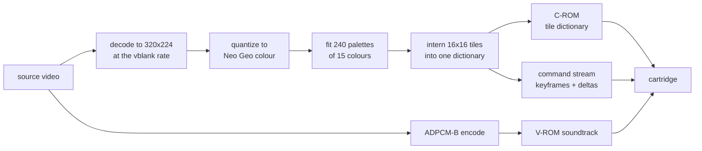
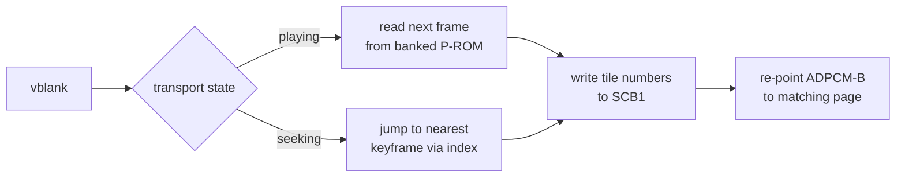

English | [日本語](README.ja.md) | [简体中文](README.zh-Hans.md) | [繁體中文（香港）](README.zh-HK.md)

<div align="center">

# Neo Geo Media Player

<strong>A full-screen film with sound on a stock Neo Geo AES,<br>
and a library that puts one inside your own game.</strong>

<br>

[](tools/tests)
[](RELEASES.md)
[](LICENSE)
[](#verification)
[](#verification)

</div>

<p align="center">
  <a href="#quick-start"><strong>Quick start</strong></a> &nbsp;|&nbsp;
  <a href="#how-it-works"><strong>How it works</strong></a> &nbsp;|&nbsp;
  <a href="#quality"><strong>Quality</strong></a> &nbsp;|&nbsp;
  <a href="#verification"><strong>Verification</strong></a> &nbsp;|&nbsp;
  <a href="#the-family"><strong>The family</strong></a>
</p>

<div align="center">


<sub>Six seconds of the Sintel trailer, captured from MAME running the built cartridge at the console's own 320x224, with the position bar showing as the film starts. The same film opens the Master System player's README. Sintel is by the Blender Foundation, CC BY 3.0.</sub>

</div>

```bash
uv --project tools run python -m neogeomedia.cartridge ~/Movies/my-film.mkv
# build/neogeomedia.neo
```

---

## What it is

**A cartridge maker.** Point it at a video file and it builds a Neo Geo cartridge that plays it, with a transport, subtitles and sound. Start at [Quick start](#quick-start).

**A library for your own game.** The same renderer, packaged so a homebrew developer can drop a cutscene into a game they are already building. One blocking call owns the screen while the movie plays and hands every register back afterwards. Start at [A movie inside your own game](#a-film-inside-your-own-game).

The cartridge is built on the library rather than beside it, so anything that breaks one breaks the other.

### The problem

The Neo Geo has no video decoder, no framebuffer, and no scaler. It draws hardware sprites and that is all. There is nowhere to put a decoded picture and nothing to decode it with: the 68000 runs at 12 MHz and has to hold 59.2 frames a second while the sound chip streams underneath it.

There are also no residuals. A codec normally fixes a bad prediction by adding a difference to what is already on screen. With no framebuffer there is nothing to add to. A correction can only point a slot at some tile that already exists.

### The solution

Nothing decodes on the console. An offline baker turns the video into cartridge ROM images, and the on-cart player pushes pre-computed tile numbers into sprite control blocks once per vblank.

The screen is a fixed grid of 20 by 14 sprite tiles, 280 slots of 16x16 pixels covering the 320x224 raster. Every distinct tile the movie needs is interned once into a global dictionary in character ROM. A frame is a list of assignments: slot 137 now shows tile 90412. There is no decompression step, because a tile number is the decoded form.

<table>
<tr>
<td width="50%" valign="top">

#### Zero runtime decoding

The player writes tile numbers into SCB1 and nothing else. A frame that changes nothing costs two bytes.

</td>
<td width="50%" valign="top">

#### A measured quality ladder

35 rungs. The rung is settled by baking the source rather than by pricing it against a table.

</td>
</tr>
<tr>
<td width="50%" valign="top">

#### Palettes refit per scene

240 CRAM banks refit per epoch and double-buffered across the hundreds of frames an epoch lasts, for about 6% less error at 1.5% more tiles.

</td>
<td width="50%" valign="top">

#### Bit-exact against geolith

A frame reconstructed from the cartridge's own bytes matches what the emulator drew, pixel for pixel, at 0.0000 error.

</td>
</tr>
<tr>
<td width="50%" valign="top">

#### Timing checked per instruction

Every build disassembles the player and fails on any VRAM write pair under the documented cycle minimum.

</td>
<td width="50%" valign="top">

#### A working transport

Play, pause, fast forward at 2x, 5x and 10x, rewind and seek, with audio re-pointed to the matching ADPCM page on every jump.

</td>
</tr>
</table>

## What every player does

The family sets one list of requirements for every player in
[FAMILY.md](FAMILY.md). Where this one stands:

| Requirement | Here |
|---|---|
| The picture fills the screen | Yes, by default. 320x224, scaled to cover and cropped, and bars baked into a source are detected and cropped first. `--fit letterbox` still exists and is due to go |
| Picture quality before frame rate | Yes. Every frame plays at the 59.2 Hz vblank rate and the quality ladder spends the room on the picture |
| Sound with no added hardware | Yes. ADPCM-B on the stock YM2610, from V-ROM |
| A silent build | Partly. A library bundle can leave sound out with `FMV_AUDIO=no`; the cartridge command has no silent flag yet. Sound lives in its own V-ROM, so leaving it out frees no character ROM for the picture |
| The whole cartridge | Yes. Up to the 128 MiB of character ROM a 20-bit tile number addresses, with no bankswitching |
| Quality follows length | Yes. `--quality search` settles the best rung that fits the film into the cartridge |
| A media-player menu | Mostly. Play, pause, fast forward, rewind, seek, and a position bar with elapsed and total time. Sound on and off is not checked yet |

## How it works



At runtime the player reads the next frame's commands and writes them straight to sprite control block 1.



A 24 fps source shown on a 59.185 Hz raster repeats each frame about 2.47 times, and every repeat is free. Over ten minutes the reference stream averages 24.6 slot updates per frame out of 280.

Keyframes rewrite all 280 slots and act as seek targets. The transport jumps anywhere by finding the nearest keyframe in an index and replaying from there. A ten minute movie carries 913 of them.

Picture quality is dictionary richness, and dictionary richness is character ROM. That fact shapes every design decision below.

## Hardware ceilings

Every value here was read from the source of two independent emulators rather than from prose.

| Resource | Ceiling | Consequence |
|---|---|---|
| Character ROM | 20-bit tile number, 1,048,576 tiles, 128 MiB | The binding constraint at every quality rung |
| Program ROM | 3-bit bank latch, 8 banks of 1 MiB | Command stream. The reference bake uses 4.5 MB across 5 banks |
| ADPCM-B voice ROM | 16 MiB of 4-bit samples through a 16-bit page counter | About 10 minutes at the chip's 55.6 kHz ceiling. Longer sources get the highest rate that still ends on an addressable page |
| Sprites per scanline | 96 | The grid uses 20 |
| Palettes | 256 banks of 16 colours, index 0 transparent | 240 for video, 16 reserved for the menu |
| Watchdog | About 0.13 seconds | Bounds any initialisation loop |
| Raster | 384 by 264 at a 6 MHz dot clock, 59.185 Hz | The same in every region |

> [!IMPORTANT]
> There is no character-ROM bankswitching, and there cannot be. Neither geolith nor MAME implements it on any board, and the arithmetic forbids it: 2^20 tiles at 128 bytes each is exactly the 128 MiB the tile number addresses. 128 MiB is an absolute ceiling, not a window.

The refresh rate carries the whole design. The player advances one movie frame per vblank and the soundtrack is paced against the frame count, so a console refreshing at a different rate would run the film slow and drift the audio away from it. geolith fixes `LSPC_SCANLINES` at 264 with no region variation, and its region setting reaches the BIOS jumper and the CD drive rather than the raster. A cartridge built here plays at the same rate on a Japanese, American, Asian or European board.

## Quick start

Any video file ffmpeg can read works. Nothing has to live in a particular folder or carry a particular name.

### Prerequisites

| Tool | Version | Install |
|:-----|:--------|:--------|
| Python | >= 3.12 | [python.org](https://www.python.org) |
| uv | latest | [docs.astral.sh/uv](https://docs.astral.sh/uv/) |
| ffmpeg and ffprobe | any recent | [ffmpeg.org](https://ffmpeg.org) |
| m68k toolchain | ngdevkit | [Toolchain](#toolchain) |
| Neo Geo BIOS | any | Only to run the emulators, not to build |

### Get the code

```bash
git clone https://github.com/gufranco/neogeo-media-player.git
```

### Make a cartridge

```bash
uv --project tools run python -m neogeomedia.cartridge ~/Movies/my-film.mkv
```

That measures the source, settles the highest quality rung that fits a cartridge, bakes it, builds the ROM, and leaves a `.neo` in `build/`. Add subtitles with `--subtitles ~/Movies/my-film.srt`, or leave the flag off and a `.srt` sitting beside the source under the same name is picked up on its own.

| Step | What it does | Roughly |
|:-----|:-------------|:--------|
| Calibrate | Samples 24 short windows and measures what the content costs in tiles | Under a minute |
| Choose | Prints the full ladder and settles the best rung that fits | Instant |
| Bake | Quantizes, fits palettes, interns every tile, encodes audio | About 8 minutes for a ten minute source |
| Build | Compiles the player and packs the ROM images | A couple of minutes |

#### What you get

| Path | What it is |
|:-----|:-----------|
| `build/neogeomedia.neo` | The cartridge. This is the file a NeoSD or an emulator loads |
| `build/neogeomedia.zip` | The same ROMs as a MAME software-list archive |
| `build/mame-hash/neogeo.xml` | The software-list entry MAME needs to find that archive |
| `build/baked/` | Intermediate ROM images, kept so the ROM can be rebuilt without re-baking |
| `build/preview.mp4` | Only when `--preview` was asked for |

#### Common flags

| Flag | Use |
|:-----|:----|
| `--subtitles PATH` | A SubRip `.srt`. Defaults to one beside the source |
| `--quality search` | The default. Bake down from `q01` until one fits, and remember it |
| `--quality q17` | Name a rung and skip the measuring |
| `--start 90 --duration 300` | Take five minutes starting at 1:30 rather than the whole file |
| `--fit letterbox` | Letterbox instead of filling the 320x224 raster |
| `--preview out.mp4` | Also render what the cartridge will show, for checking by eye |
| `--bake-only` | Stop before the ROM build |
| `--build-dir DIR` | Put everything somewhere other than `build/` |

### Running it

On hardware, copy `build/neogeomedia.neo` to a NeoSD flash cart and load it like any other title.

Under MAME, point it at the archive and the hash file the build wrote, with the BIOS directory on the ROM path:

```bash
mame aes -bios unibios23 -cart neogeomedia \
    -rompath build:/path/to/bios -hashpath build/mame-hash
```

[`verify_mame.sh`](tools/scripts/verify_mame.sh) does that staging and then compares what MAME drew against the baker's own render.

Under a libretro front end, load `build/neogeomedia.neo` with the geolith core and set `geolith_overscan_*` to zero to see all 320 columns.

### Toolchain

The cartridge needs an `m68k-neogeo-elf` toolchain. Ubuntu takes it from ngdevkit's PPA, which publishes amd64 only. Apple Silicon takes it natively from the Homebrew tap:

```bash
brew install --force-bottle dciabrin/ngdevkit/ngdevkit-toolchain \
                            dciabrin/ngdevkit/ngdevkit
```

> [!TIP]
> `--force-bottle` pours the arm64 bottle on a macOS release the tap has not tagged yet. Without it Homebrew builds GCC from source.

[`build-in-docker.sh`](toolchain/build-in-docker.sh) compiles directly when a toolchain is on the path and otherwise runs itself inside the toolchain image, as the calling user. The [`Dockerfile`](Dockerfile) pins that image: Ubuntu by digest, its packages from a dated snapshot, and the three ngdevkit packages by exact version and SHA-256, listed in [`toolchain/ngdevkit.sha256`](toolchain/ngdevkit.sha256). A build today and a build next year produce the same ROM.

### A film inside your own game

The renderer is a library, and the baker emits it as a folder you drop into an ngdevkit project. Everything ships as source.

```bash
uv --project tools run python -m neogeomedia.bake \
    --source intro.mkv --quality q17 --duration 30 \
    --build-dir build --bundle game/fmv
```

That writes `game/fmv/` holding the library source, the baked movie, a `.mk` fragment and an integration guide written against the movie you just baked. Add one line to your `Makefile`, point the cartridge at the movie's ROM images, and call it:

```c
#include "fmv.h"
#include "movie_data.h"

fmv_options options = fmv_defaults();

options.skip_pad = FMV_PAD_A | FMV_PAD_B;
switch (fmv_play(&fmv_movie_data, &options)) {
case FMV_FINISHED: break;
case FMV_SKIPPED:  break;
}
game_redraw();
```

`fmv_play` blocks until the movie ends or the player skips it. Underneath it are `fmv_open`, `fmv_start`, `fmv_tick`, `fmv_seek` and `fmv_close` for a caller that wants to drive its own loop.

#### What it takes, and what it leaves you

| Resource | The movie takes | Yours |
|---|---|---|
| Sprites | 20, from `options.first_sprite` | Every other sprite |
| Palette banks | From the bake's `--base-bank` upward | Everything below it |
| C-ROM tiles | 0 up to the dictionary size | The rest of the 128 MiB, reserved up front with `--tile-budget` |
| P-ROM banks | As many as the stream needs, from `FMV_FIRST_BANK` | The other banks, and the whole fixed megabyte |
| Fix layer | Nothing at all | All of it |
| Z80 and the M1 ROM | Nothing, unless you ask for sound | Yours by default |

> [!WARNING]
> Your code must live in the fixed first megabyte. The library switches the P-ROM bank latch to read the stream, so code running from a switchable bank would disappear underneath itself.

**The machine state it restores is the state you declare.** The LSPC mode register, the fix-source and palette-bank latches and the bank latch are all write-only: reading `0x3A0000` upward returns the last word on the bus, and reading `0x3C0006` returns the raster line counter rather than the mode. Nothing can save those by reading them. `fmv_defaults()` fills in what a plain cartridge uses, and a caller that runs auto-animation or the board fix ROM says so once.

**Sound is opt-in.** The video path needs no sound driver, so a game that already owns the M1 ROM keeps it. The movie's soundtrack is ADPCM-B driven by three Z80 commands, and the reference driver ships as source to read or merge.

[`examples/cutscene/`](examples/cutscene) is a game that plays a cutscene and carries on, built from an emitted folder in a stock ngdevkit project at a pinned commit. Its title screen is drawn after the movie returns, writing fix tiles and nothing else, so a register left in the wrong place would show.

## Quality

Tile cost is a property of the content rather than of the running time. Dense animation can cost several times what a dialogue scene costs, so a ladder indexed by duration alone would over-compress easy sources and under-compress hard ones. The baker measures the source instead.

The same four clips at `q17`, as tiles per minute and as the runtime a full 128 MiB C-ROM would hold:

| Clip | Tiles per minute | Fits |
|:-----|-----------------:|-----:|
| Big Buck Bunny, animation | 56,622 | 18.5 min |
| blue_sky, live action | 287,279 | 3.7 min |
| mobcal, live action | 409,600 | 2.6 min |
| parkrun, live action | 616,623 | 1.7 min |

Flat-shaded animation is the best case for a tile dictionary by a wide margin. A feature shot on film wants a rung far down the ladder, and `search` is how to find which one.

`--quality search` is the default and consults no table. It bakes `q01` first, and when that does not fit it doubles its stride, `q02`, `q04`, `q08`, until something fits, then bisects the span that doubling just proved. Cost falls strictly from each rung to the next, so the rungs that fit are a block at the bottom of the ladder and only its boundary has to be found. A film settling deep costs about nine bakes rather than thirty.

A rung has to fit on its own terms. Rate control degrades a picture to keep it inside the budget, so a rung that only fits because the controller reached its ceiling does not count as fitting.

Every rung it settles is written to [`neogeomedia-tiers.json`](neogeomedia-tiers.json), which is meant to be committed: what it holds is a property of the film and the ladder rather than of one workstation, so checking it in lets anyone building the same cartridge skip the same bakes.

To see the ladder before committing to a long run, `neogeomedia.plan` prints every rung with its exact overshoot in about two minutes and bakes nothing:

```bash
uv --project tools run python -m neogeomedia.plan --source film.mkv
```

[`docs/quality-ladder.md`](docs/quality-ladder.md) lists all 35 rungs with their settings, and covers per-scene palettes, rate control and the colour model.

### The reference cartridge

Big Buck Bunny is the test subject rather than the product: freely licensed, long enough to stress the dictionary, and unchanging between runs, so numbers taken from it are comparable.

| Quantity | Value |
|---|---|
| Rung | `q17`, colour at 37% |
| Frames | 35,274 at 59.2 fps, no holds |
| C-ROM | 846,784 tiles, 81% of 128 MiB |
| Palette epochs | 120, cadence from 6.0 measured cuts per minute |
| Audio | 55,555 Hz, the chip's ceiling |
| Displayed error | 0.0010116 |
| Cartridge | 158 MB |

Audio and video stay locked. Read off the player's own diagnostics counters, the player runs 8 to 9 frames behind the vblank count at 1,800 frames and at 12,000, so the offset is the cost of booting before the movie starts rather than drift. Audio starts immediately after frame 0 is applied and the YM2610 then streams from the same crystal as the raster. Residual error is 3 ms from the ADPCM rate grid across ten minutes, 3 ms from the frame-to-page mapping, and up to 4.6 ms rounding on each seek.

A five minute source with grain added at the cartridge's own resolution was built to sit at the edge of the C-ROM deliberately. `--quality search` settled it at `q01` in a single bake at 209,667 tiles per minute, so five minutes came to 1,048,338 tiles against a ceiling of 1,048,576. The 150 MB cartridge boots in MAME and draws the picture with the grain intact.

## Verification

Every hardware encoding this project depends on was read from emulator source rather than from documentation, and the test suite carries independent transcriptions of geolith's tile reader and stream player used as oracles. geolith and MAME share no code, so agreement between them is evidence about the board rather than about one reading of the wiki.

The strongest check reconstructs a frame from the cartridge's own bytes, replaying the command stream into a VRAM model and rendering from the packed character ROM, then compares that against what the emulator drew.

| Emulator | Result on the ten minute cartridge |
|---|---|
| geolith | Exact. 0.0000 error, pixel for pixel |
| MAME | 1.0066 mean, 5 of 255 worst, plus column 0 |

MAME returns column 0 black across all 224 rows. Excluding it, the residual is a smooth per-level difference, which is the signature of a different digital-to-analog model rather than a structural disagreement.

### On real hardware

The cartridge has run on a real AES and on a real MVS from a NeoSD flash cart. Both played the full ten minutes with the picture filling the raster, the soundtrack holding sync across the run, and the transport responding.

| Claim | What the run settles |
|---|---|
| Tile encoding, C-ROM packing, palette upload | The picture is correct on silicon, not only in a model of it |
| VRAM writes past the blanking interval | Permitted in practice, as the wiki says |
| ADPCM-B rate and the frame-to-page mapping | Audio holds sync across ten minutes without drifting audibly |
| 3-bit bank latch, 5 P-ROM banks, 120 palette epochs | The stream survives every bank crossing to the end of the film |
| Keyframe seek index and the audio re-point | Seek, rewind and fast forward behave as designed |

A clean run is not a cycle measurement, so the write-spacing minimums stay sourced from documentation and enforced by the build gate rather than confirmed by observation. [`docs/hardware.md`](docs/hardware.md) carries the bit layouts read out of both decoders and what the timing gate checks on every build.

The [cutscene example](examples/cutscene) has run on a board too and came back to its own title screen normally after the movie. That screen writes fix tiles and nothing else, so the fix source, the palette bank and the LSPC mode all have to be where the caller left them for it to appear. No emulator can settle that, because those registers cannot be read back on the machine either.

## Repository layout

| Path | Contents |
|---|---|
| [`src/fmv/`](src/fmv) | The library: VRAM setup, the sprite grid, palette epochs, the per-frame replay, keyframe seek, and the optional ADPCM-B paging |
| [`src/player/`](src/player) | The movie cartridge, built on the library. Transport, menu, subtitles, diagnostics |
| [`examples/cutscene/`](examples/cutscene) | A game that plays a cutscene and carries on, built from an emitted bundle |
| [`tools/neogeomedia/`](tools/neogeomedia) | The baker: decode, colour, palettes, dictionary, encoder, quality ladder, audio, ROM containers, bundle emission |
| [`tools/tests/`](tools/tests) | 944 tests, including the emulator transcriptions used as oracles |
| [`tools/scripts/`](tools/scripts) | Capture, verification, timing and ladder-sweep helpers |
| [`toolchain/`](toolchain) | The ngdevkit build, native or containerised |
| [`FAMILY.md`](FAMILY.md) | The standard shared with sms-media-player and fmv-core-python, identical in each |
| [`CHANGELOG.md`](CHANGELOG.md) | What was measured, and what was rejected |
| [`RELEASES.md`](RELEASES.md) | Generated release notes, one entry per version |

## Development

| Command | What it does |
|:--------|:-------------|
| `uv --project tools sync --all-groups` | Install the baker and its dev tools |
| `uv --project tools run python -m pytest tools/tests` | Run the 944 tests |
| `uv --project tools run ruff format --check tools/` | Format gate |
| `uv --project tools run ruff check tools/` | Lint gate |
| `uv --project tools run mypy tools/neogeomedia tools/scripts` | Type gate |
| `make rom` | Build the ROM from whatever is already baked, in the pinned toolchain image |
| `make analyse` | Static analysis of the player with cppcheck, which must exit 0 |
| `make timing` | VRAM write spacing in the compiled objects, after `make rom` |
| `make shell` | A shell inside the toolchain image |
| `bash tools/scripts/verify_mame.sh` | Compare a finished cartridge against MAME |

Coverage is gated at 95% in [CI](.github/workflows/ci.yml), which also builds a cartridge end to end and builds the cutscene example twice, once video-only and once with the movie's own sound driver.

### Conventions

| Convention | Source |
|------------|--------|
| Commit format | [Conventional Commits](https://www.conventionalcommits.org/), enforced on every pull request |
| Versioning | [python-semantic-release](https://python-semantic-release.readthedocs.io/), driven by commit subjects |
| Lint and format | [ruff](https://docs.astral.sh/ruff/), configured in [`tools/pyproject.toml`](tools/pyproject.toml) |
| Types | [mypy](https://mypy-lang.org/) in strict mode |
| Dependency updates | [Dependabot](.github/dependabot.yml), weekly |

### Stability

From 2.0 these are a promise. Anything that would break them is a major version.

| Surface | Promise |
|:--------|:--------|
| `python -m neogeomedia.cartridge <source>` | The one command. Its flags keep their names and meanings |
| `python -m neogeomedia.plan --source <file>` | Prints the ladder as an estimate and bakes nothing |
| `python -m neogeomedia.bake --bundle DIR` | Emits a drop-in folder. Its shape keeps its names: `DIR/src/`, `DIR/movie/`, `DIR/package/`, `DIR/fmv.mk`, `DIR/README.md` |
| Rung names `q01` to `q35` | A name always means the same settings. Rungs are never renumbered |
| [`neogeomedia-tiers.json`](neogeomedia-tiers.json) | Readable, diffable, and safe to commit. Its `version` field guards the shape |
| `build/neogeomedia.neo` and `build/neogeomedia.zip` | Where the cartridge lands, and what it is called |
| Exit codes | 0 on success, non-zero on failure, and a distinct code when a bake ran out of dictionary |

The C library surface is [`fmv.h`](src/fmv/fmv.h):

| Promised | Not promised |
|:---------|:-------------|
| `fmv_defaults`, `fmv_play` | The layout of `fmv_movie` and `fmv_player`. They are declared so a caller can allocate them, not so it can read them |
| `fmv_open`, `fmv_start`, `fmv_tick`, `fmv_hold`, `fmv_pause`, `fmv_resume`, `fmv_seek`, `fmv_close` | Anything under [`src/fmv/`](src/fmv) other than `fmv.h`. `hw.h` is internal and moves without notice |
| `fmv_ended`, `fmv_position`, `fmv_last_updates`, `fmv_epoch`, `fmv_stream_bank` | The `MOVIE_` defines in the generated header, which describe one bake rather than an interface |
| The fields of `fmv_options`, and their defaults | |
| The `fmv.mk` variables a project reads: `FMV_OBJS`, `FMV_CFLAGS`, `FMV_LDFLAGS`, `FMV_CROM_BYTES`, `FMV_PROM2_BYTES`, `FMV_VROM_BYTES`, `FMV_FIRST_FREE_TILE`, `FMV_FIRST_BANK`, `FMV_AUDIO` | |

An emitted folder carries the library source it was baked against, and compiling one against the other across a major version stops the build with both versions named.

`python -m neogeomedia.bake` carries knobs that exist to be experimented with, so its surface can move apart from `--bundle`. The numbers a bake reports in `report.json` are measurements rather than an interface.

### Versioning

This project follows [Semantic Versioning](https://semver.org/). Every release is tagged and the version is derived from commit subjects. See [releases](https://github.com/gufranco/neogeo-media-player/releases) and [`RELEASES.md`](RELEASES.md).

## FAQ

<details>
<summary><strong>Can I put a movie in the game I am already building?</strong></summary>
<br>

Yes. Bake with `--bundle DIR` and you get a folder to drop into an ngdevkit project: the library as source, the baked movie, a `.mk` fragment and a guide written against the movie you baked.

What you give up is C-ROM, since the movie's tile dictionary and your own sprites come out of the same 128 MiB with no bankswitching between them, and the fixed first megabyte of program ROM, since the library switches the bank latch to read the stream.

</details>

<details>
<summary><strong>Why not just use a video codec?</strong></summary>
<br>

There is nothing to run it on. The console has no video decoder and no framebuffer, and the 68000 at 12 MHz has roughly 18,000 cycles of blanking per frame, which is about what rewriting the screen once already costs. Every codec technique that assumes a residual path fails here, because a correction cannot nudge a pixel. It can only point a slot at a tile that already exists.

</details>

<details>
<summary><strong>How long does a bake take?</strong></summary>
<br>

About eight minutes for a ten minute source, scaling with runtime. Calibration runs in about two minutes, which is why the ladder is printed with every rung's exact overshoot before anything commits to a bake.

</details>

<details>
<summary><strong>How much runtime fits?</strong></summary>
<br>

It depends on how much novel detail the content carries rather than on length. Flat-shaded animation reaches roughly 18 minutes at `q17`; grainy live action reaches under two. Audio caps at about 10 minutes at the chip's 55.6 kHz ceiling, and longer sources get the highest rate that still ends on an addressable page.

</details>

<details>
<summary><strong>Why is the picture 320 pixels wide when real cartridges use 304?</strong></summary>
<br>

Because narrowing it costs tiles instead of saving them. Blanking 16 pixels on each side of a test window moved the tile count up, from 35,136 to 35,779, while blanking the same 32 pixels down the middle took it to 30,098. Cost follows novel detail, and framing puts the detail in the middle.

</details>

## The family

This player is one of a family that plays full-motion video on consoles that
were never meant to show it. The members share one standard,
[FAMILY.md](FAMILY.md), and every piece of baker code the hardware does not
force lives once in the core.

| Member | What it is |
|:--|:--|
| [neogeo-media-player](https://github.com/gufranco/neogeo-media-player) | This repository |
| [sms-media-player](https://github.com/gufranco/sms-media-player) | A full-screen film on a Sega Master System, its tiles paged through VRAM as it plays |
| [fmv-core-python](https://github.com/gufranco/fmv-core-python) | The baker and measurement code the players share |

## Licence and credits

[MIT](LICENSE).

Built with [ngdevkit](https://github.com/dciabrin/ngdevkit). Verified against [geolith](https://github.com/libretro/geolith-libretro) and [MAME](https://github.com/mamedev/mame). The demo film is the Sintel trailer, and the test footage is Big Buck Bunny and Tears of Steel, all by the Blender Foundation under CC BY.

ngdevkit is LGPL-3.0 and this project is MIT. Two conventions were followed rather than invented: that an object whose file name contains `__bank` belongs in switchable program ROM, and that a cartridge is declared through a `rom.mk` and built through a `Makefile` that includes it. Both are interface rather than implementation. No file from ngdevkit or from `ngdevkit-examples` is copied into this repository, and the [cutscene example](examples/cutscene) fetches a stock project at build time instead of vendoring one. The cartridges built here link ngdevkit's libraries, which is the use LGPL-3.0 is written for. No binary is distributed from this repository; everything ships as source.
