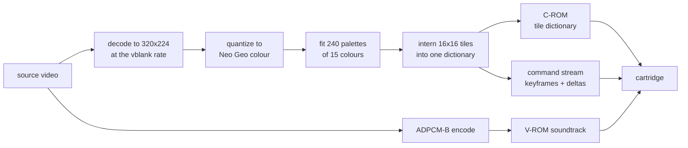
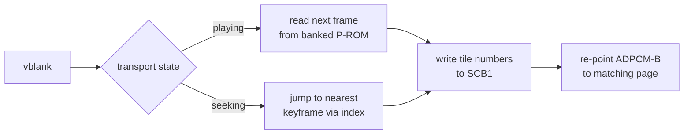

<div align="center">

# Neo Geo Media Player

<strong>A full-screen film with sound on a stock Neo Geo AES,<br>
and a library that puts one inside your own game.</strong>

English | [日本語](README.ja.md) | [简体中文](README.zh-Hans.md) | [繁體中文（香港）](README.zh-HK.md)

[](https://github.com/gufranco/neogeo-media-player/actions/workflows/ci.yml)
[](RELEASES.md)
[](LICENSE)
[](#hardware-ceilings)
[](#verification)

</div>

<p align="center">
  <a href="#quick-start"><strong>Quick start</strong></a> |
  <a href="#how-it-works"><strong>How it works</strong></a> |
  <a href="#quality"><strong>Quality</strong></a> |
  <a href="#verification"><strong>Verification</strong></a> |
  <a href="#the-family"><strong>The family</strong></a>
</p>

<div align="center">


<sub>Six seconds of the Sintel trailer, captured from MAME running the built cartridge at the console's own 320x224, with the position bar showing as the film starts. The same film opens the Master System player's README. Sintel is by the Blender Foundation, CC BY 3.0.</sub>

</div>

```bash
uv --project tools run python -m neogeomedia.cartridge ~/Movies/my-film.mkv
# build/neogeomedia.neo
```

---

## What it is

**A cartridge maker.** Point it at a video file and it builds a Neo Geo cartridge that plays it, with a transport, subtitles and sound. Start at [Quick start](#quick-start).

**A library for your own game.** The same renderer, packaged so a homebrew developer can drop a cutscene into a game they are already building. One blocking call owns the screen while the movie plays and hands every register back afterwards. Start at [A movie inside your own game](#a-film-inside-your-own-game).

The cartridge is built on the library rather than beside it, so anything that breaks one breaks the other.

### The problem

The Neo Geo has no video decoder, no framebuffer, and no scaler. It draws hardware sprites and that is all. There is nowhere to put a decoded picture and nothing to decode it with: the 68000 runs at 12 MHz and has to hold 59.2 frames a second while the sound chip streams underneath it.

There are also no residuals. A codec normally fixes a bad prediction by adding a difference to what is already on screen. With no framebuffer there is nothing to add to. A correction can only point a slot at some tile that already exists.

### The solution

Nothing decodes on the console. An offline baker turns the video into cartridge ROM images, and the on-cart player pushes pre-computed tile numbers into sprite control blocks once per vblank.

The screen is a fixed grid of 20 by 14 sprite tiles, 280 slots of 16x16 pixels covering the 320x224 raster. Every distinct tile the movie needs is interned once into a global dictionary in character ROM. A frame is a list of assignments: slot 137 now shows tile 90412. There is no decompression step, because a tile number is the decoded form.

<table>
<tr>
<td width="50%" valign="top">

#### Zero runtime decoding

The player writes tile numbers into SCB1 and nothing else. A frame that changes nothing costs two bytes.

</td>
<td width="50%" valign="top">

#### A measured quality ladder

35 rungs. The rung is settled by baking the source rather than by pricing it against a table.

</td>
</tr>
<tr>
<td width="50%" valign="top">

#### Palettes refit per scene

240 CRAM banks refit per epoch and double-buffered across the hundreds of frames an epoch lasts, for about 6% less error at 1.5% more tiles.

</td>
<td width="50%" valign="top">

#### Bit-exact against geolith

A frame reconstructed from the cartridge's own bytes matches what the emulator drew, pixel for pixel, at 0.0000 error.

</td>
</tr>
<tr>
<td width="50%" valign="top">

#### Timing checked per instruction

Every build disassembles the player and fails on any VRAM write pair under the documented cycle minimum.

</td>
<td width="50%" valign="top">

#### A working transport

Play, pause, fast forward at 2x, 5x and 10x, rewind and seek, with audio re-pointed to the matching ADPCM page on every jump.

</td>
</tr>
</table>

### Where it stands

The whole path runs: preprocessing, the encoder, the quality ladder, the ROM containers, the 68000 player and the transport.

| Piece | State |
|---|---|
| Encoder and quality ladder | Working. 35 rungs, settled by baking the film rather than by pricing it against a table |
| Picture | 320x224, the whole raster. A source of another shape is cropped to fill it |
| 68000 player | Working. A build gate disassembles it and fails on any VRAM write pair under the documented minimum |
| Sound | ADPCM-B on the YM2610, up to 55,555 Hz. `--silent` leaves it out |
| Subtitles | A SubRip `.srt` named with `--subtitles`, or one beside the source under the same name, drawn on the fix layer, at most two lines of 40 columns. Down switches them off and on |
| Controls | The transport in [Running it](#running-it): play, pause, fast forward, rewind, seek, mute, subtitles, stop and the diagnostics, with a menu that shows for three seconds after any press |
| Field rate | 59.185 Hz on every board, so a cartridge plays at the same speed in every region |
| Regression set | Six clips of different kinds baked on every test run |
| Hardware run | Done on a real AES and a real MVS from a NeoSD, and again on 2026-10-17 with the changes listed in [AGENTS.md](AGENTS.md), with no defect seen |

## What every player does

Both players are built to the same feature list, set in [FAMILY.md](FAMILY.md),
and this table is the same in both READMEs. "Planned" is work not done yet. A
feature a console cannot carry says "Not possible" with the hardware reason.

| Feature | Neo Geo | Master System | Game Gear |
|---|---|---|---|
| One command from a video file to a cartridge | Yes | Yes | Yes, `--target gg` |
| The picture fills the screen, scaled to cover and cropped | Yes | Yes | Yes, the 160 by 144 panel |
| Black bars baked into a source are found and cropped | Yes | Yes | Yes |
| Picture and sound step down from the best until the film fits | Yes. `--quality search` bakes down a 35-rung ladder, and sound takes the highest rate that still fits | Yes. A bake that overruns the cartridge steps the frame rate down through the same search, and sound goes last | Yes, the same search as the Master System |
| The largest standard cartridge, no added hardware | Yes, 128 MiB of character ROM | Yes, 1 MB, the most any Sega mapper revision decodes | Yes, 1 MB, the same mapper |
| Ordered dithering | Yes, `--dither`, off by default | Yes, `--dither`, on by default | Yes, `--dither`, on by default |
| Palettes refit as the film changes | Yes, per scene | Yes, per frame, kept while they still fit | Yes, per frame, from 4096 colours |
| Sound with no added hardware | Yes, ADPCM-B on the YM2610 | Yes, tone synthesis on the PSG | Yes, tone synthesis on the PSG, routed left and right on the headphones from a stereo source |
| A silent build that gives sound's room to the picture | Yes, `--silent`. Sound has its own ROM, so leaving it out frees no picture room | Yes, `--silent` | Yes, `--silent` |
| Subtitles from a SubRip file | Yes | Yes, burned into the picture, so they cannot be switched off | Yes, burned into the picture, so they cannot be switched off |
| Play and pause | Yes | Yes. Pause on the console, Start on a Game Gear | Yes, Start |
| Fast forward and rewind | Yes, forward at 2x, 5x and 10x | Not possible: moving one frame already takes up to 54,000 of a field's 59,736 T-states, so the replay cannot move two; Left and Right jump between seek points instead | Not possible, for the Master System's reason: one frame takes up to 54,000 of a field's 59,736 T-states |
| Seek | Yes, C and D jump between points 10 seconds apart, `--seek-every` to change | Yes, Left and Right jump between points 10 seconds apart, `--seek-every` to change | Yes, Left and Right jump between points 10 seconds apart, `--seek-every` to change |
| A position bar with elapsed and total time | Yes, for three seconds after any press | Yes, for three seconds after any press, and while paused | Yes, for three seconds after any press, and while paused |
| Restart and stop | Yes | Yes | Yes |
| Sound on and off | Yes | Yes, Up | Yes, Up |
| The film loops at the end | Yes | Yes | Yes |
| A diagnostics overlay | Yes, Select | Yes, Down | Yes, Down |
| A fault screen for a corrupt stream | Yes | Yes | Yes |
| A film inside your own game | Yes, `--bundle` emits a drop-in library | Yes, `--bundle` emits a drop-in library and `examples/cutscene` builds a game from it | Yes, `--bundle` with `--target gg` emits a Game Gear library |
| A preview of what the console will draw | Yes, a video, or four frames beside their source | Yes, a video, or four frames beside their source | Yes, a video, or four frames beside their source |
| A write-timing gate on every build | Yes | Yes | Yes |
| A regression set of films baked on every test run | Yes, six films | Yes, six films | Yes, the same six films baked into the Game Gear window |
| Run on the original hardware | Yes, AES and MVS | Yes, a Master System and a Game Gear | Planned: the Master System cartridge has run on a Game Gear, the native one has not yet |

## How it works



At runtime the player reads the next frame's commands and writes them straight to sprite control block 1.



A 24 fps source shown on a 59.185 Hz raster repeats each frame about 2.47 times, and every repeat is free. Over ten minutes the reference stream averages 24.6 slot updates per frame out of 280.

Keyframes rewrite all 280 slots and act as seek targets. The transport jumps anywhere by finding the nearest keyframe in an index and replaying from there. A ten minute movie carries 913 of them.

### The constraint that shapes everything

This player and the Master System's [`smsgg-media-player`](https://github.com/gufranco/smsgg-media-player) are members of one family, and the two machines differ in the one dimension the design leans on.

The Neo Geo holds **1,048,576 tiles resident in character ROM**, so the player writes tile numbers into sprite control blocks and does nothing else at runtime. The Master System addresses 512 patterns in 16 KB of VRAM, so its player has to page the film's patterns in while it plays.

| | Neo Geo | Master System |
|---|---|---|
| Binding constraint | Character ROM | Cartridge bytes |
| Per-frame work | Write tile numbers | Upload patterns, then write name table entries |
| New component | none | A working-set policy deciding what to evict |

Picture quality is dictionary richness, and dictionary richness is character ROM. That fact shapes every design decision below.

### The picture is the whole screen

All 320 by 224 pixels, with nothing framing it. A source of another shape is scaled until it covers the raster and then cropped to it, so a 16:9 film loses about a fifth of its width and every pixel the console draws carries film. Bars would be tiles like any other, interned into the dictionary and drawn every frame, so there is no option to add them.

### Sound

Sound is ADPCM-B on the YM2610, streamed from its own voice ROM. The baker encodes the soundtrack at the chip's ceiling of 55,555 Hz when the film is short enough, and a longer film gets the highest rate whose last sample still lands on an addressable page of the 16 MiB voice ROM, which comes to about ten minutes at the ceiling. The player starts the stream after frame 0 and re-points it to the matching page on every seek, rewind and fast forward. `--silent` leaves sound out; it lives in its own ROM, so the picture gains nothing from it.

### Prior art

- **Resident Evil 2 on the Nintendo 64.** Angel Studios fit 15 minutes of video into a 24 MiB budget, decoded in software with no video hardware. Chroma subsampling is the technique the family carries, as the chroma weight on the shared Oklab metric. [Angel Studios postmortem](https://www.gamedeveloper.com/programming/postmortem-angel-studios-i-resident-evil-2-i-n64-version-)
- **RoQ**, used by The 11th Hour and Quake III: a vector quantizer with per-frame codebooks capped at 256 entries, so a bounded number of new fragments enter per frame. This is the shape of the baker's tile dictionary with a per-frame cap. [MultimediaWiki](https://wiki.multimedia.cx/index.php/RoQ)
- **Bad Apple on the Neo Geo** by HPMAN: 320x224, 13,167 frames, about four minutes in roughly 3 MB. One bit and one palette, so tile deduplication is at its best case, but it shows tile-streamed video with synced audio on real hardware. [yAronet](https://www.yaronet.com/topics/188010-bad-apple-demo-datlibdatimageneosoundbuilder)

## Hardware ceilings

Every value here was read from the source of two independent emulators rather than from prose.

| Resource | Ceiling | Consequence |
|---|---|---|
| Character ROM | 20-bit tile number, 1,048,576 tiles, 128 MiB | The binding constraint at every quality rung |
| Program ROM | 3-bit bank latch, 8 banks of 1 MiB | Command stream. The reference bake uses 4.5 MB across 5 banks |
| ADPCM-B voice ROM | 16 MiB of 4-bit samples through a 16-bit page counter | About 10 minutes at the chip's 55.6 kHz ceiling. Longer sources get the highest rate that still ends on an addressable page |
| Sprites per scanline | 96 | The grid uses 20 |
| Palettes | 256 banks of 16 colours, index 0 transparent | 240 for video, 16 reserved for the menu |
| Watchdog | About 0.13 seconds | Bounds any initialisation loop |
| Raster | 384 by 264 at a 6 MHz dot clock, 59.185 Hz | The same in every region |

> [!IMPORTANT]
> There is no character-ROM bankswitching, and there cannot be. Neither geolith nor MAME implements it on any board, and the arithmetic forbids it: 2^20 tiles at 128 bytes each is exactly the 128 MiB the tile number addresses. 128 MiB is an absolute ceiling, not a window.

The refresh rate carries the whole design. The player advances one movie frame per vblank and the soundtrack is paced against the frame count, so a console refreshing at a different rate would run the film slow and drift the audio away from it. geolith fixes `LSPC_SCANLINES` at 264 with no region variation, and its region setting reaches the BIOS jumper and the CD drive rather than the raster. A cartridge built here plays at the same rate on a Japanese, American, Asian or European board.

## Quick start

Any video file ffmpeg can read works. Nothing has to live in a particular folder or carry a particular name.

### Prerequisites

| Tool | Version | Install |
|:-----|:--------|:--------|
| Python | 3.14, fetched by uv from [`.python-version`](.python-version) | |
| uv | latest | [docs.astral.sh/uv](https://docs.astral.sh/uv/) |
| ffmpeg and ffprobe | any recent | [ffmpeg.org](https://ffmpeg.org) |
| Docker | any recent | [docs.docker.com](https://docs.docker.com/get-docker/) |
| Neo Geo BIOS | any | Only to run the emulators, not to build |

### Get the code

The baker shares its decode, colour, film and capture code with the Master
System player through the [fmv-core-python](https://github.com/gufranco/fmv-core-python)
submodule, so clone with submodules. A source archive from the download button
cannot carry a submodule and does not run.

```bash
git clone --recurse-submodules https://github.com/gufranco/neogeo-media-player.git
git submodule update --init   # in a clone made without the flag
```

### Make a cartridge

```bash
uv --project tools run python -m neogeomedia.cartridge ~/Movies/my-film.mkv
```

That measures the source, settles the highest quality rung that fits a cartridge, bakes it, builds the ROM, and leaves a `.neo` in `build/`. Add subtitles with `--subtitles ~/Movies/my-film.srt`, or leave the flag off and a `.srt` sitting beside the source under the same name is picked up on its own.

| Step | What it does | Roughly |
|:-----|:-------------|:--------|
| Calibrate | Samples 24 short windows and measures what the content costs in tiles | Under a minute |
| Choose | Prints the full ladder and settles the best rung that fits | Instant |
| Bake | Quantizes, fits palettes, interns every tile, encodes audio | About 8 minutes for a ten minute source |
| Build | Compiles the player and packs the ROM images | A couple of minutes |

#### What you get

| Path | What it is |
|:-----|:-----------|
| `build/neogeomedia.neo` | The cartridge. This is the file a NeoSD or an emulator loads |
| `build/neogeomedia.zip` | The same ROMs as a MAME software-list archive |
| `build/mame-hash/neogeo.xml` | The software-list entry MAME needs to find that archive |
| `build/baked/` | Intermediate ROM images, kept so the ROM can be rebuilt without re-baking |
| `build/report.json` | The bake's figures, written even when the film is refused |
| `build/preview.mp4` | Only when `--preview` was asked for |

#### Common flags

| Flag | Use |
|:-----|:----|
| `--subtitles PATH` | A SubRip `.srt`. Defaults to one beside the source |
| `--quality search` | The default. Bake down from `q01` until one fits, and remember it |
| `--quality q17` | Name a rung and skip the measuring |
| `--denoise 1` | A denoise strength. With the default search it is measured on the film, and `auto` measures it for a named rung too |
| `--start 90 --duration 300` | Take five minutes starting at 1:30 rather than the whole file |
| `--preview out.mp4` | Also render what the cartridge will show, for checking by eye. A `.png` holds four frames beside their source instead |
| `--silent` | Leave sound out. Sound has its own ROM, so the picture gains no room |
| `--seek-every 10` | Seconds between the points C and D jump to. At least one frame |
| `--dither 0.5` | An ordered dither strength from 0 to 1. Default: 0, no dither |
| `--bundle DIR` | A folder to write a drop-in copy of the player library and this film into |
| `--bake-only` | Stop before the ROM build |
| `--build-dir DIR` | Put everything somewhere other than `build/` |

### Running it

On hardware, copy `build/neogeomedia.neo` to a NeoSD flash cart and load it like any other title.

The film starts playing on its own. The controls show on any press and step out of the picture a few seconds later:

| Button | What it does |
|:-------|:-------------|
| A | Pause and play |
| B | Play at normal speed |
| Right | Fast forward, 2x, then 5x, then 10x |
| Left | Rewind |
| C, D | Jump to the seek point before or after, 10 seconds apart by default. Within 2 seconds of a point, C goes to the one before |
| Up | Sound on and off |
| Down | Subtitles on and off |
| Start | Stop on a black screen. Start, A or B then plays from the beginning |
| Select | The diagnostics overlay |

A corrupt stream stops the film on a red screen rather than drawing garbage.

Under MAME, point it at the archive and the hash file the build wrote, with the BIOS directory on the ROM path:

```bash
mame aes -bios unibios23 -cart neogeomedia \
    -rompath build:/path/to/bios -hashpath build/mame-hash
```

[`verify_mame.sh`](tools/scripts/verify_mame.sh) does that staging and then compares what MAME drew against the baker's own render.

Under a libretro front end, load `build/neogeomedia.neo` with the geolith core and set `geolith_overscan_*` to zero to see all 320 columns.

### Toolchain

Every ROM build goes through Docker, and there is no host toolchain path. [`build-in-docker.sh`](toolchain/build-in-docker.sh) runs itself inside the toolchain image as the calling user, even when an `m68k-neogeo-elf` toolchain is on the host's path. The [`Dockerfile`](Dockerfile) pins that image: Ubuntu by digest, every package by exact version from a dated snapshot, and the three ngdevkit packages by exact version and SHA-256, listed in [`toolchain/ngdevkit.sha256`](toolchain/ngdevkit.sha256). ngdevkit's PPA publishes amd64 only, so the image is amd64 everywhere and Docker emulates it on Apple Silicon. A build today and a build next year produce the same ROM.

### A film inside your own game

The renderer is a library, and the baker emits it as a folder you drop into an ngdevkit project. Everything ships as source.

```bash
uv --project tools run python -m neogeomedia.bake \
    --source intro.mkv --quality q17 --duration 30 \
    --build-dir build --bundle game/fmv
```

That writes `game/fmv/` holding the library source, the baked movie, a `.mk` fragment and an integration guide written against the movie you just baked. Add one line to your `Makefile`, point the cartridge at the movie's ROM images, and call it:

```c
#include "fmv.h"
#include "movie_data.h"

fmv_options options = fmv_defaults();

options.skip_pad = FMV_PAD_A | FMV_PAD_B;
switch (fmv_play(&fmv_movie_data, &options)) {
case FMV_FINISHED: break;
case FMV_SKIPPED:  break;
}
game_redraw();
```

`fmv_play` blocks until the movie ends or the player skips it. Underneath it are `fmv_open`, `fmv_start`, `fmv_tick`, `fmv_seek` and `fmv_close` for a caller that wants to drive its own loop.

#### What it takes, and what it leaves you

| Resource | The movie takes | Yours |
|---|---|---|
| Sprites | 20, from `options.first_sprite` | Every other sprite |
| Palette banks | From the bake's `--base-bank` upward | Everything below it |
| C-ROM tiles | 0 up to the dictionary size | The rest of the 128 MiB, reserved up front with `--tile-budget` |
| P-ROM banks | As many as the stream needs, from `FMV_FIRST_BANK` | The other banks, and the whole fixed megabyte |
| Fix layer | Nothing at all | All of it |
| Z80 and the M1 ROM | Nothing, unless you ask for sound | Yours by default |

> [!WARNING]
> Your code must live in the fixed first megabyte. The library switches the P-ROM bank latch to read the stream, so code running from a switchable bank would disappear underneath itself.

**The machine state it restores is the state you declare.** The LSPC mode register, the fix-source and palette-bank latches and the bank latch are all write-only: reading `0x3A0000` upward returns the last word on the bus, and reading `0x3C0006` returns the raster line counter rather than the mode. Nothing can save those by reading them. `fmv_defaults()` fills in what a plain cartridge uses, and a caller that runs auto-animation or the board fix ROM says so once.

**Sound is opt-in.** The video path needs no sound driver, so a game that already owns the M1 ROM keeps it. The movie's soundtrack is ADPCM-B driven by three Z80 commands, and the reference driver ships as source to read or merge.

[`examples/cutscene/`](examples/cutscene) is a game that plays a cutscene and carries on, built from an emitted folder in a stock ngdevkit project at a pinned commit. Its title screen is drawn after the movie returns, writing fix tiles and nothing else, so a register left in the wrong place would show. `make example` builds it from `build/bundle` in the toolchain image, and `make example FMV_AUDIO=yes` builds it with the movie's own sound driver.

## Quality

Tile cost is a property of the content rather than of the running time. Dense animation can cost several times what a dialogue scene costs, so a ladder indexed by duration alone would over-compress easy sources and under-compress hard ones. The baker measures the source instead.

### How the picture is judged

`--quality search` is the default and consults no table. It bakes `q01` first, and when that does not fit it doubles its stride, `q02`, `q04`, `q08`, until something fits, then bisects the span that doubling just proved. Cost falls strictly from each rung to the next, so the rungs that fit are a block at the bottom of the ladder and only its boundary has to be found. A film settling deep costs about nine bakes rather than thirty.

A rung has to fit on its own terms. Rate control degrades a picture to keep it inside the budget, so a rung that only fits because the controller reached its ceiling does not count as fitting.

Every rung it settles is written to [`neogeomedia-tiers.json`](neogeomedia-tiers.json), which is meant to be committed: what it holds is a property of the film and the ladder rather than of one workstation, so checking it in lets anyone building the same cartridge skip the same bakes.

To see the ladder before committing to a long run, `neogeomedia.plan` prints every rung with its exact overshoot in about two minutes and bakes nothing:

```bash
uv --project tools run python -m neogeomedia.plan --source film.mkv
```

[`docs/quality-ladder.md`](docs/quality-ladder.md) lists all 35 rungs with their settings, and covers per-scene palettes, rate control and the colour model.

A number decides cost and a person decides quality. `displayed_error` once ranked frame blending the strongest lever available, and on the cartridge it read as a smear, so every change to the picture is also judged by eye on a rendered frame.

### Measured and rejected

Each of these was built and measured before being turned off. [`CHANGELOG.md`](CHANGELOG.md) has the full account.

- **Frame blending**: error from 23.33 to 9.11 at a fixed hold, and a visible smear on the cartridge. The metric scores an average of neighbouring frames as closer to the source than a stale frame, and the eye does not
- **Motion masking**: across factors from 20 to 3000 the tile count did not move by one entry while error rose fourfold. A deferred correction still points at a tile, interned later regardless
- **A narrower raster**: blanking the outer 16 pixels each side raised the tile count from 35,136 to 35,779. Cost follows novel detail, and framing puts detail in the middle
- **Flip deduplication**: 67 tiles saved out of 81,044. Exact 16x16 mirrors do not occur in filmed or rendered material
- **Compressing the command stream, and auto-animation**: both save stream bytes, and the stream used 4.5 MB of 8 MiB
- **Palette-only fades**: 35.7% of frames change at all, and only 4.6% of those are one global brightness scale
- **Sprite-position motion compensation**: the grid tiles the raster, so moving a sprite shifts a whole 16-pixel column, and content almost never pans by exactly one tile
- **Near-duplicate merging in the dictionary**: 1% to 3% at thresholds fine enough to be invisible; only signatures coarse enough to destroy detail reach 48%
- **A richer rung than `q17` on the reference film**: `q16` fits at 82% of the C-ROM and returns the same `displayed_error` to six decimals for 12,697 more tiles. The rate controller's ceiling binds at the top of the ladder, not the C-ROM
- **Dithering the source before quantisation**: no measurable effect. The banding comes from the 15 colours a tile may use, not from the colour word

### Kept

- **Settling the rung by baking**: the ladder's own price table was wrong in both directions, 53% too dear on animation and 13% too cheap on live action, so `--quality search` bakes and never consults it. A deep film settles in about nine bakes rather than thirty
- **Palettes refit per scene**: 240 CRAM banks refit per epoch and double-buffered, for about 6% less error at 1.5% more tiles
- **A calibration anchor on a frame-hold rung**: the hold rungs had been extrapolated, up to 26% optimistic; a fourth anchor measures them
- **24 short calibration windows**: window count, not sample length, sets the accuracy. 3 windows read 0.62 of the true rate and 12 read 0.91; 24 land within a percent for 72 seconds of sampling
- **Measured denoise per film**: a two-second window at 0, 1, 2 and 4, scored against the undenoised source on the blurred error. It picks 1 for the Popeye cartoon, 1.7% lower error with fewer tiles, and 0 for the other five films
- **Ordered dithering, off by default**: an 8x8 threshold inside palette assignment, which keeps identical tiles interning as one, 54,250 tiles to 54,192 on a 30-second window. It loses on all six films, displayed error 5% to 33% higher, so it ships off and waits on the owner's verdict

### What a cartridge costs

The same four clips at `q17`, as tiles per minute and as the runtime a full 128 MiB C-ROM would hold:

| Clip | Tiles per minute | Fits |
|:-----|-----------------:|-----:|
| Big Buck Bunny, animation | 56,622 | 18.5 min |
| blue_sky, live action | 287,279 | 3.7 min |
| mobcal, live action | 409,600 | 2.6 min |
| parkrun, live action | 616,623 | 1.7 min |

Flat-shaded animation is the best case for a tile dictionary by a wide margin. A feature shot on film wants a rung far down the ladder, and `search` is how to find which one. Nothing shortens a film to make it fit: a source that fits on no rung is refused with the `--duration` that would fit.

### The reference cartridge

Big Buck Bunny is the test subject rather than the product: freely licensed, long enough to stress the dictionary, and unchanging between runs, so numbers taken from it are comparable.

| Quantity | Value |
|---|---|
| Rung | `q17`, colour at 37% |
| Frames | 35,274 at 59.2 fps, no holds |
| C-ROM | 846,784 tiles, 81% of 128 MiB |
| Palette epochs | 120, cadence from 6.0 measured cuts per minute |
| Audio | 55,555 Hz, the chip's ceiling |
| Displayed error | 0.0010116 |
| Cartridge | 158 MB |

Audio and video stay locked. Read off the player's own diagnostics counters, the player runs 8 to 9 frames behind the vblank count at 1,800 frames and at 12,000, so the offset is the cost of booting before the movie starts rather than drift. Audio starts immediately after frame 0 is applied and the YM2610 then streams from the same crystal as the raster. Residual error is 3 ms from the ADPCM rate grid across ten minutes, 3 ms from the frame-to-page mapping, and up to 4.6 ms rounding on each seek.

A five minute source with grain added at the cartridge's own resolution was built to sit at the edge of the C-ROM deliberately. `--quality search` settled it at `q01` in a single bake at 209,667 tiles per minute, so five minutes came to 1,048,338 tiles against a ceiling of 1,048,576. The 150 MB cartridge boots in MAME and draws the picture with the grain intact.

## Verification

Every hardware encoding this project depends on was read from emulator source rather than from documentation, and the test suite carries independent transcriptions of geolith's tile reader and stream player used as oracles. geolith and MAME share no code, so agreement between them is evidence about the board rather than about one reading of the wiki.

The strongest check reconstructs a frame from the cartridge's own bytes, replaying the command stream into a VRAM model and rendering from the packed character ROM, then compares that against what the emulator drew.

| Emulator | Result on the ten minute cartridge |
|---|---|
| geolith | Exact. 0.0000 error, pixel for pixel |
| MAME | 1.0066 mean, 5 of 255 worst, plus column 0 |

MAME returns column 0 black across all 224 rows. Excluding it, the residual is a smooth per-level difference, which is the signature of a different digital-to-analog model rather than a structural disagreement.

### On real hardware

The cartridge has run on a real AES and on a real MVS from a NeoSD flash cart. Both played the full ten minutes with the picture filling the raster, the soundtrack holding sync across the run, and the transport responding.

| Claim | What the run settles |
|---|---|
| Tile encoding, C-ROM packing, palette upload | The picture is correct on silicon, not only in a model of it |
| VRAM writes past the blanking interval | Permitted in practice, as the wiki says |
| ADPCM-B rate and the frame-to-page mapping | Audio holds sync across ten minutes without drifting audibly |
| 3-bit bank latch, 5 P-ROM banks, 120 palette epochs | The stream survives every bank crossing to the end of the film |
| Keyframe seek index and the audio re-point | Seek, rewind and fast forward behave as designed |

A clean run is not a cycle measurement, so the write-spacing minimums stay sourced from documentation and enforced by the build gate rather than confirmed by observation. [`docs/hardware.md`](docs/hardware.md) carries the bit layouts read out of both decoders and what the timing gate checks on every build.

The [cutscene example](examples/cutscene) has run on a board too and came back to its own title screen normally after the movie. That screen writes fix tiles and nothing else, so the fix source, the palette bank and the LSPC mode all have to be where the caller left them for it to appear. No emulator can settle that, because those registers cannot be read back on the machine either.

## Repository layout

| Path | Contents |
|---|---|
| [`src/fmv/`](src/fmv) | The library: VRAM setup, the sprite grid, palette epochs, the per-frame replay, keyframe seek, and the optional ADPCM-B paging |
| [`src/player/`](src/player) | The movie cartridge, built on the library. Transport, menu, subtitles, diagnostics |
| [`examples/cutscene/`](examples/cutscene) | A game that plays a cutscene and carries on, built from an emitted bundle |
| [`tools/neogeomedia/`](tools/neogeomedia) | The baker: decode, colour, palettes, dictionary, encoder, quality ladder, audio, ROM containers, bundle emission |
| [`tools/tests/`](tools/tests) | The test suite, including the emulator transcriptions used as oracles |
| [`tools/clips.manifest.json`](tools/clips.manifest.json) | The regression films: identity, credit and licence, never the films |
| [`tools/DESIGN.md`](tools/DESIGN.md) | Why each baker module, script and test is shaped as it is, with the measurements behind it |
| [`tools/scripts/`](tools/scripts) | Capture, verification, timing and ladder-sweep helpers |
| [`toolchain/`](toolchain) | The ngdevkit build, run in the toolchain image |
| [`FAMILY.md`](FAMILY.md) | The standard shared with smsgg-media-player and fmv-core-python, identical in each |
| [`CHANGELOG.md`](CHANGELOG.md) | What was measured, and what was rejected |
| [`RELEASES.md`](RELEASES.md) | Generated release notes, one entry per version |

## Development

```bash
# Install the baker and its dev tools
uv --project tools sync --all-groups

# Run the tests
uv --project tools run python -m pytest tools/tests

# Format gate
uv --project tools run ruff format --check tools/

# Lint gate
uv --project tools run ruff check tools/

# Type gate
uv --project tools run mypy tools/neogeomedia tools/scripts

# Build the ROM from whatever is already baked, in the pinned toolchain image
make rom

# Static analysis of the player with cppcheck, which must exit 0
make analyse

# VRAM write spacing in the compiled objects, after make rom
make timing

# A shell inside the toolchain image
make shell

# Compare a finished cartridge against MAME
bash tools/scripts/verify_mame.sh

# Fetch and verify the regression films
uv --project tools run python tools/scripts/fetch_clips.py
```

The regression set bakes six clips of deliberately different kinds. They are
not in the repository and are not ours to redistribute, so the manifest holds
their identity and the script above fetches and verifies them. Without them
only the committed synthetic clip runs, and the gate is much weaker. Every
credit and licence is in [`tools/clips.manifest.json`](tools/clips.manifest.json).

Coverage is gated at 95% in [CI](.github/workflows/ci.yml), which also builds a cartridge end to end and builds the example twice, once video-only and once with the movie's own sound driver.

### Documentation

| File | Contents |
|---|---|
| [`AGENTS.md`](AGENTS.md) | The engineering contract: the hardware's binding numbers with their sources, the gates, and what is not done |
| [`FAMILY.md`](FAMILY.md) | The standard shared with smsgg-media-player and fmv-core-python, identical in each |
| [`tools/DESIGN.md`](tools/DESIGN.md) | Why each baker module, script and test is shaped as it is, with the measurements behind it |
| [`docs/hardware.md`](docs/hardware.md) | The bit layouts read out of both emulators and what the timing gate checks |
| [`docs/quality-ladder.md`](docs/quality-ladder.md) | All 35 rungs with their settings |
| [`CHANGELOG.md`](CHANGELOG.md) | What was tried, measured and rejected, and what each failure cost |
| [`RELEASES.md`](RELEASES.md) | Version history, generated from commit subjects |
| [`Dockerfile`](Dockerfile) | The toolchain image, with every package pinned by version and the ngdevkit packages by SHA-256 |
| [`tools/clips.manifest.json`](tools/clips.manifest.json) | The regression films: identity, credit and licence, never the films |

### Conventions

| Convention | Source |
|------------|--------|
| Commit format | [Conventional Commits](https://www.conventionalcommits.org/), enforced on every pull request |
| Versioning | [python-semantic-release](https://python-semantic-release.readthedocs.io/), driven by commit subjects |
| Lint and format | [ruff](https://docs.astral.sh/ruff/), configured in [`tools/pyproject.toml`](tools/pyproject.toml) |
| Types | [mypy](https://mypy-lang.org/) in strict mode |
| Dependency updates | [Dependabot](.github/dependabot.yml), weekly |

### Stability

From 2.0 these are a promise. Anything that would break them is a major version.

| Surface | Promise |
|:--------|:--------|
| `python -m neogeomedia.cartridge <source>` | The one command. Its flags keep their names and meanings |
| `python -m neogeomedia.plan --source <file>` | Prints the ladder as an estimate and bakes nothing |
| `python -m neogeomedia.cartridge <source> --bundle DIR` | Emits a drop-in folder. Its shape keeps its names: `DIR/src/`, `DIR/movie/`, `DIR/package/`, `DIR/fmv.mk`, `DIR/README.md` |
| Rung names `q01` to `q35` | A name always means the same settings. Rungs are never renumbered |
| [`neogeomedia-tiers.json`](neogeomedia-tiers.json) | Readable, diffable, and safe to commit. Its `version` field guards the shape |
| `build/neogeomedia.neo` and `build/neogeomedia.zip` | Where the cartridge lands, and what it is called |
| Exit codes | 0 on success, non-zero on failure, and a distinct code when a bake ran out of dictionary |

The C library surface is [`fmv.h`](src/fmv/fmv.h):

| Promised | Not promised |
|:---------|:-------------|
| `fmv_defaults`, `fmv_play` | The layout of `fmv_movie` and `fmv_player`. They are declared so a caller can allocate them, not so it can read them |
| `fmv_open`, `fmv_start`, `fmv_tick`, `fmv_prepare`, `fmv_hold`, `fmv_pause`, `fmv_resume`, `fmv_seek`, `fmv_set_audio`, `fmv_close` | Anything under [`src/fmv/`](src/fmv) other than `fmv.h`. `hw.h` is internal and moves without notice |
| `fmv_ended`, `fmv_faulted`, `fmv_position`, `fmv_last_updates`, `fmv_epoch`, `fmv_stream_bank` | The `MOVIE_` defines in the generated header, which describe one bake rather than an interface |
| The fields of `fmv_options`, and their defaults | |
| The `fmv.mk` variables a project reads: `FMV_OBJS`, `FMV_CFLAGS`, `FMV_LDFLAGS`, `FMV_CROM_BYTES`, `FMV_PROM2_BYTES`, `FMV_VROM_BYTES`, `FMV_FIRST_FREE_TILE`, `FMV_FIRST_BANK`, `FMV_AUDIO` | |

An emitted folder carries the library source it was baked against, and compiling one against the other across a major version stops the build with both versions named.

`python -m neogeomedia.bake` carries knobs that exist to be experimented with, so its surface can move apart from `--bundle`. The numbers a bake reports in `report.json` are measurements rather than an interface.

### Versioning

This project follows [Semantic Versioning](https://semver.org/). Every release is tagged and the version is derived from commit subjects. See [releases](https://github.com/gufranco/neogeo-media-player/releases) and [`RELEASES.md`](RELEASES.md).

## FAQ

<details>
<summary><strong>Can I put a movie in the game I am already building?</strong></summary>
<br>

Yes. Bake with `--bundle DIR` and you get a folder to drop into an ngdevkit project: the library as source, the baked movie, a `.mk` fragment and a guide written against the movie you baked.

What you give up is C-ROM, since the movie's tile dictionary and your own sprites come out of the same 128 MiB with no bankswitching between them, and the fixed first megabyte of program ROM, since the library switches the bank latch to read the stream.

</details>

<details>
<summary><strong>Why not just use a video codec?</strong></summary>
<br>

There is nothing to run it on. The console has no video decoder and no framebuffer, and the 68000 at 12 MHz has about 30,000 cycles of blanking per frame, while rewriting every one of the 280 slots costs about 18,000 of them. Every codec technique that assumes a residual path fails here, because a correction cannot nudge a pixel. It can only point a slot at a tile that already exists.

</details>

<details>
<summary><strong>How long does a bake take?</strong></summary>
<br>

About eight minutes for a ten minute source, scaling with runtime. Calibration runs in about two minutes, which is why the ladder is printed with every rung's exact overshoot before anything commits to a bake.

</details>

<details>
<summary><strong>How much runtime fits?</strong></summary>
<br>

It depends on how much novel detail the content carries rather than on length. Flat-shaded animation reaches roughly 18 minutes at `q17`; grainy live action reaches under two. Audio caps at about 10 minutes at the chip's 55.6 kHz ceiling, and longer sources get the highest rate that still ends on an addressable page.

</details>

<details>
<summary><strong>Why is the picture 320 pixels wide when real cartridges use 304?</strong></summary>
<br>

Because narrowing it costs tiles instead of saving them. Blanking 16 pixels on each side of a test window moved the tile count up, from 35,136 to 35,779, while blanking the same 32 pixels down the middle took it to 30,098. Cost follows novel detail, and framing puts the detail in the middle.

</details>

## The family

This player is one of a family that plays full-motion video on consoles that
were never meant to show it. The members share one standard,
[FAMILY.md](FAMILY.md), and every piece of baker code the hardware does not
force lives once in the core.

| Member | What it is |
|:--|:--|
| [neogeo-media-player](https://github.com/gufranco/neogeo-media-player) | This repository |
| [smsgg-media-player](https://github.com/gufranco/smsgg-media-player) | A full-screen film on a Sega Master System, its tiles paged through VRAM as it plays |
| [fmv-core-python](https://github.com/gufranco/fmv-core-python) | The baker and measurement code the players share |

## Licence and credits

[MIT](LICENSE).

Built with [ngdevkit](https://github.com/dciabrin/ngdevkit). Verified against [geolith](https://github.com/libretro/geolith-libretro) and [MAME](https://github.com/mamedev/mame). The demo film is the Sintel trailer, and the test footage is Big Buck Bunny and Tears of Steel, all by the Blender Foundation under CC BY.

ngdevkit is LGPL-3.0 and this project is MIT. Two conventions were followed rather than invented: that an object whose file name contains `__bank` belongs in switchable program ROM, and that a cartridge is declared through a `rom.mk` and built through a `Makefile` that includes it. Both are interface rather than implementation. No file from ngdevkit or from `ngdevkit-examples` is copied into this repository, and the [cutscene example](examples/cutscene) fetches a stock project at build time instead of vendoring one. The cartridges built here link ngdevkit's libraries, which is the use LGPL-3.0 is written for. No binary is distributed from this repository; everything ships as source.
