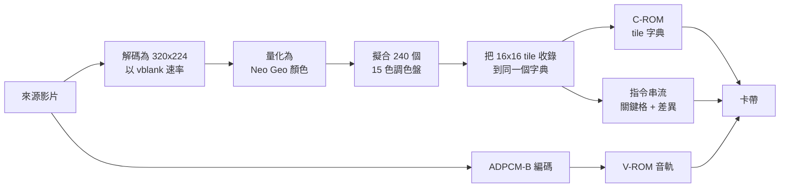

<div align="center">

# Neo Geo Media Player

<strong>在原裝 Neo Geo AES 上播放有聲音的全螢幕影片，<br>
並提供一個程式庫，把影片放進你自己的遊戲。</strong>

[English](README.md) &nbsp;|&nbsp; [日本語](README.ja.md) &nbsp;|&nbsp; [简体中文](README.zh-Hans.md) &nbsp;|&nbsp; 繁體中文（香港）

[](https://github.com/gufranco/neogeo-media-player/actions/workflows/ci.yml)
[](RELEASES.md)
[](LICENSE)
[](#硬件上限)
[](#驗證)

</div>

<p align="center">
  <a href="#快速開始"><strong>快速開始</strong></a> &nbsp;|&nbsp;
  <a href="#運作原理"><strong>運作原理</strong></a> &nbsp;|&nbsp;
  <a href="#質素"><strong>質素</strong></a> &nbsp;|&nbsp;
  <a href="#驗證"><strong>驗證</strong></a> &nbsp;|&nbsp;
  <a href="#播放器家族"><strong>系列</strong></a>
</p>

<div align="center">


<sub>Sintel 預告片的六秒片段，擷取自以主機原生 320x224 運行建置好卡帶的 MAME，影片開始時顯示位置列。Master System 播放器的 README 開首也是同一部影片。Sintel 由 Blender Foundation 製作，採用 CC BY 3.0。</sub>

</div>

```bash
uv --project tools run python -m neogeomedia.cartridge ~/Movies/my-film.mkv
# build/neogeomedia.neo
```

---

## 這是甚麼

**卡帶製作工具。** 指定一個影片檔案，它便會建置一個可播放該影片的 Neo Geo 卡帶，附播放控制、字幕和聲音。請從[快速開始](#快速開始)入手。

**供你自己遊戲使用的程式庫。** 同一個渲染器經過封裝，讓自製遊戲開發者可以把過場動畫放進正在製作的遊戲。一個阻塞式呼叫在影片播放期間接管螢幕，播放後交還每一個暫存器。請從[在你自己的遊戲中播放影片](#在你自己的遊戲中播放影片)入手。

卡帶建基於程式庫，而不是與之並列，所以任何令其中一方出錯的改動，也會令另一方出錯。

### 問題

Neo Geo 沒有影片解碼器、沒有影格緩衝區，也沒有縮放器。它只會繪製硬件 sprite，僅此而已。解碼後的畫面無處可放，也沒有東西可以用來解碼：68000 以 12 MHz 運行，必須維持每秒 59.2 格，同時音效晶片在底下串流。

此外也沒有殘差。編解碼器通常會在畫面上已有的內容加上差值，以修正不準確的預測。沒有影格緩衝區，就沒有東西可以加上去。修正只能把一個槽位指向某個已存在的 tile。

### 解決方法

主機上不作任何解碼。離線烘焙器把影片轉成卡帶 ROM 映像，卡帶上的播放器則在每次 vblank 把預先計算好的 tile 編號寫入 sprite 控制區塊。

螢幕是固定的 20 x 14 sprite tile 網格，共 280 個 16x16 像素的槽位，覆蓋 320x224 的光柵。影片需要的每個不同 tile，都只會在字元 ROM 的一個全域字典中收錄一次。一格畫面就是一串指派：槽位 137 現在顯示 tile 90412。沒有解壓步驟，因為 tile 編號本身就是解碼後的形式。

<table>
<tr>
<td width="50%" valign="top">

#### 執行時零解碼

播放器只把 tile 編號寫入 SCB1，別無其他。一格沒有任何變化的畫面只需兩個位元組。

</td>
<td width="50%" valign="top">

#### 經實測的質素階梯

35 級。級別由實際烘焙來源決定，而不是對照表格估價。

</td>
</tr>
<tr>
<td width="50%" valign="top">

#### 按場景重新擬合調色盤

240 個 CRAM bank 每個 epoch 重新擬合，並在一個 epoch 持續的數百格之間雙緩衝，以多 1.5% 的 tile 換取約少 6% 的誤差。

</td>
<td width="50%" valign="top">

#### 與 geolith 逐位元一致

由卡帶自身位元組重建的畫面，與模擬器繪製的逐像素相符，誤差為 0.0000。

</td>
</tr>
<tr>
<td width="50%" valign="top">

#### 逐條指令檢查時序

每次建置都會反組譯播放器，只要任何一對 VRAM 寫入的間隔低於文件記載的最少週期數，建置即告失敗。

</td>
<td width="50%" valign="top">

#### 可用的播放控制

播放、暫停、2x、5x 和 10x 快進、倒帶及跳轉，每次跳躍都會把音訊重新指向對應的 ADPCM 頁。

</td>
</tr>
</table>

### 現況

整條流程都能運作：預處理、編碼器、質素階梯、ROM 容器、68000 播放器及播放控制。

| 組件 | 狀態 |
|---|---|
| 編碼器及質素階梯 | 可用。共 35 級，透過實際烘焙影片來決定，而不是對照表格估價 |
| 畫面 | 320x224，整個光柵。其他比例的來源會被裁切以填滿畫面 |
| 68000 播放器 | 可用。建置關卡會反組譯它，只要有一對 VRAM 寫入低於文件訂明的最小值便會失敗 |
| 聲音 | YM2610 上的 ADPCM-B，最高 55,555 Hz。`--silent` 會略去聲音 |
| 字幕 | 以 `--subtitles` 指定的 SubRip `.srt`，或與來源同名並放在旁邊的那個，繪製在 fix 層上，最多兩行、每行 40 欄。下鍵可以關閉及開啟 |
| 操控 | [運行](#運行)中的播放控制：播放、暫停、快進、倒帶、跳轉、靜音、字幕、停止及診斷，按下任何按鍵後選單會顯示三秒 |
| 場頻 | 在任何主機板上都是 59.185 Hz，所以卡帶在任何地區都以相同速度播放 |
| 回歸測試集 | 六段不同類型的片段在每次測試時烘焙 |
| 硬件運行 | 已經由 NeoSD 在真實的 AES 及 MVS 上運行；2026-10-17 又連同 [AGENTS.md](AGENTS.md) 中列出的改動再次運行，未見任何缺陷 |

## 每個播放器都具備的功能

兩個播放器都按照 [FAMILY.md](FAMILY.md) 訂下的同一份功能清單製作，而這個表格在兩份 README 中完全相同。「已計劃」表示尚未完成的工作。主機無法承載的功能會標示為「無法做到」，並附上硬件原因。

| 功能 | Neo Geo | Master System | Game Gear |
|---|---|---|---|
| 一個指令就能把影片檔製成卡帶 | 是 | 是 | 是，`--target gg` |
| 畫面填滿螢幕，縮放至覆蓋後裁切 | 是 | 是 | 是，填滿 160×144 的螢幕 |
| 偵測並裁去來源中烘入的黑邊 | 是 | 是 | 是 |
| 畫面及聲音由最佳質素逐級降低，直至影片放得進 | 是。`--quality search` 沿 35 級階梯向下烘焙，聲音採用仍放得進的最高取樣率 | 是。超出卡帶的烘焙會用同一搜尋逐級降低幀率，聲音最後才略去 | 是，與 Master System 使用同一搜尋 |
| 最大的標準卡帶，無需額外硬件 | 是，128 MiB 字元 ROM | 是，1 MB，任何 Sega 映射器版本可定址的上限 | 是，1 MB，同一映射器 |
| 有序抖色 | 是，`--dither`，預設關閉 | 是，`--dither`，預設啟用 | 是，`--dither`，預設啟用 |
| 隨影片變化重新擬合調色盤 | 是，按場景 | 是，按幀，仍然適用時會保留 | 是，按幀從 4096 種顏色中擬合 |
| 無需額外硬件的聲音 | 是，在 YM2610 上使用 ADPCM-B | 是，PSG 音調合成 | 是，PSG 音調合成，並按立體聲來源在耳機左右聲道之間分配 |
| 把聲音的空間讓給畫面的無聲建置 | 是，`--silent`。聲音有獨立的 ROM，所以省略聲音不會為畫面騰出空間 | 是，`--silent` | 是，`--silent` |
| 來自 SubRip 檔案的字幕 | 是 | 是，燒錄進畫面，因此無法關閉 | 是，燒錄進畫面，因此無法關閉 |
| 播放及暫停 | 是 | 是。主機上的暫停鍵，Game Gear 上的 Start 鍵 | 是，Start 鍵 |
| 快進及倒帶 | 是，快進速度為 2x、5x 及 10x | 不可能：單是傳輸一幀，已用去每場 59,736 個 T 狀態中最多 54,000 個，重播無法傳輸兩幀；改用左右鍵在跳轉點之間跳轉 | 不可能，原因與 Master System 相同：單是傳輸一幀，已用去每場 59,736 個 T 狀態中最多 54,000 個 |
| 跳轉 | 是，C 及 D 鍵在相隔 10 秒的位置之間跳轉，可用 `--seek-every` 更改 | 是，左右鍵在相隔 10 秒的位置之間跳轉，可用 `--seek-every` 更改 | 是，左右鍵在相隔 10 秒的位置之間跳轉，可用 `--seek-every` 更改 |
| 顯示已播放時間及總時間的位置列 | 是，按下任何按鍵後顯示三秒 | 是，按下任何按鍵後顯示三秒，暫停時亦會顯示 | 是，按下任何按鍵後顯示三秒，暫停時亦會顯示 |
| 重新開始及停止 | 是 | 是 | 是 |
| 聲音開關 | 是 | 是，上鍵 | 是，上鍵 |
| 影片播放完畢後循環播放 | 是 | 是 | 是 |
| 診斷資訊疊加層 | 是，Select 鍵 | 是，下鍵 | 是，下鍵 |
| 串流損毀時的錯誤畫面 | 是 | 是 | 是 |
| 在你自己的遊戲中播放影片 | 是，`--bundle` 會產生可直接嵌入的程式庫 | 是，`--bundle` 會產生可直接嵌入的程式庫，`examples/cutscene` 用它建置一個遊戲 | 是，`--bundle` 配合 `--target gg` 會產生 Game Gear 用的程式庫 |
| 預覽主機將會繪製的畫面 | 是，影片，或四幀畫面並列於其來源旁 | 是，影片，或四幀畫面並列於其來源旁 | 是，影片，或四幀畫面並列於其來源旁 |
| 每次建置都檢查寫入時序 | 是 | 是 | 是 |
| 每次測試都會烘焙的回歸影片集 | 是，六段影片 | 是，六段影片 | 已計劃：六段影片目前只為 Master System 烘焙 |
| 在原裝硬件上運行 | 是，AES 及 MVS | 是，Master System 及 Game Gear | 已計劃：Master System 卡帶已在 Game Gear 上運行，原生卡帶尚未運行 |

## 運作原理



執行時，播放器讀取下一格的指令，並直接寫入 sprite 控制區塊 1。


24 fps 的來源在 59.185 Hz 的光柵上顯示，每格約重複 2.47 次，而每次重複都不花費任何成本。在十分鐘內，參考串流平均每格更新 280 個槽位中的 24.6 個。

關鍵格會重寫全部 280 個槽位，並作為跳轉目標。播放控制會在索引中找出最近的關鍵格，從那裡重新播放，從而跳到任何位置。一部十分鐘的影片帶有 913 個關鍵格。

### 決定一切的限制

這個播放器與 Master System 的 [`smsgg-media-player`](https://github.com/gufranco/smsgg-media-player) 是同一系列的成員，兩部機器只在設計所倚賴的那一個方面不同。

Neo Geo **在字元 ROM 中常駐 1,048,576 個 tile**，所以播放器只需把 tile 編號寫入 sprite 控制區塊，執行時不做其他事。Master System 只能定址 16 KB VRAM 中的 512 個圖案，所以它的播放器必須在播放時把影片的圖案分頁載入。

| | Neo Geo | Master System |
|---|---|---|
| 約束所在 | 字元 ROM | 卡帶字節數 |
| 每格的工作 | 寫入 tile 編號 | 上傳圖案，然後寫入名稱表項目 |
| 新增組件 | 沒有 | 決定逐出甚麼的工作集策略 |

畫面質素就是字典的豐富程度，而字典的豐富程度就是字元 ROM。這個事實決定了以下每一項設計。

### 畫面就是整個螢幕

全部 320x224 個像素，沒有任何邊框。其他比例的來源會被縮放至覆蓋整個光柵，然後裁切，所以 16:9 的影片會失去約五分之一的闊度，遊戲機繪製的每一個像素都是影片。黑邊和其他 tile 一樣會被收入字典、每格繪製，所以沒有加上黑邊的選項。

### 聲音

聲音是 YM2610 上的 ADPCM-B，從獨立的語音 ROM 串流播放。影片夠短時，烘焙器以晶片上限 55,555 Hz 編碼音軌；較長的影片會得到最後一個取樣仍落在 16 MiB 語音 ROM 可定址頁面上的最高取樣率，以上限計約為十分鐘。播放器在第 0 格之後開始播放音訊串流，並在每次跳轉、倒帶及快進時把它重新指向對應的頁面。`--silent` 會略去聲音；聲音有獨立的 ROM，所以畫面不會因此騰出空間。

### 前人成果

- **N64 版《Biohazard 2》。** Angel Studios 把 15 分鐘影片放進 24 MiB 的預算，在沒有視訊硬件的情況下以軟件解碼。色度子取樣是本系列沿用的技術，體現為共用 Oklab 指標中的色度權重。[Angel Studios 檢討](https://www.gamedeveloper.com/programming/postmortem-angel-studios-i-resident-evil-2-i-n64-version-)
- **RoQ**，用於 The 11th Hour 及 Quake III：一種向量量化器，每格碼本上限為 256 項，所以每格加入的新片段數目有限。這正是烘焙器設有每格上限的 tile 字典的形態。[MultimediaWiki](https://wiki.multimedia.cx/index.php/RoQ)
- **HPMAN 的 Neo Geo 版 Bad Apple**：320x224，13,167 格，約四分鐘，放在約 3 MB 之內。一位元、一個調色盤，所以 tile 去重處於最佳情況，但它證明了附同步音訊的 tile 串流影片能在真實硬件上運行。[yAronet](https://www.yaronet.com/topics/188010-bad-apple-demo-datlibdatimageneosoundbuilder)

## 硬件上限

這裏每個數值都是從兩個獨立模擬器的原始碼讀出，而不是取自文字說明。

| 資源 | 上限 | 影響 |
|---|---|---|
| 字元 ROM | 20 位元 tile 編號，1,048,576 個 tile，128 MiB | 在每個質素級別都是決定性的限制 |
| 程式 ROM | 3 位元 bank 鎖存器，8 個 1 MiB 的 bank | 指令串流。參考烘焙用了 5 個 bank 共 4.5 MB |
| ADPCM-B 語音 ROM | 16 MiB 的 4 位元取樣，經 16 位元頁計數器存取 | 以晶片 55.6 kHz 的上限約 10 分鐘。較長的來源會取用仍能在可定址頁結束的最高速率 |
| 每條掃描線的 sprite | 96 | 網格用了 20 |
| 調色盤 | 256 個 16 色 bank，索引 0 為透明 | 240 個用於影片，16 個保留給選單 |
| 看門狗 | 約 0.13 秒 | 限制任何初始化迴圈的長度 |
| 光柵 | 384 x 264，6 MHz 點時脈，59.185 Hz | 每個地區都相同 |

> [!IMPORTANT]
> 沒有字元 ROM 的 bankswitching，也不可能有。geolith 和 MAME 都沒有在任何主機板上實作，而算術也不容許：2^20 個 tile，每個 128 位元組，正好是 tile 編號可定址的 128 MiB。128 MiB 是絕對上限，而不是一個視窗。

整個設計建基於刷新率。播放器每次 vblank 前進一格影片，音軌按影格計數控制節奏，所以刷新率不同的主機會令影片播得較慢，音訊也會逐漸與畫面脫節。geolith 把 `LSPC_SCANLINES` 固定為 264，沒有地區差異，其地區設定影響的是 BIOS 跳線和 CD 光碟機，而不是光柵。這裏建置的卡帶，在日本、美國、亞洲或歐洲的主機板上都以相同速率播放。

## 快速開始

任何 ffmpeg 能讀取的影片檔案都可以。檔案不必放在特定資料夾，也不必使用特定名稱。

### 先決條件

| 工具 | 版本 | 安裝 |
|:-----|:--------|:--------|
| Python | 3.14，由 uv 按 [`.python-version`](.python-version) 取得 | |
| uv | 最新 | [docs.astral.sh/uv](https://docs.astral.sh/uv/) |
| ffmpeg 和 ffprobe | 任何近期版本 | [ffmpeg.org](https://ffmpeg.org) |
| Docker | 任何近期版本 | [docs.docker.com](https://docs.docker.com/get-docker/) |
| Neo Geo BIOS | 任何 | 只在運行模擬器時需要，建置時不需要 |

### 取得程式碼

烘焙器透過 [fmv-core-python](https://github.com/gufranco/fmv-core-python) 子模組與 Master System 播放器共用解碼、色彩、影片及擷取程式碼，因此請連同子模組一併複製。下載按鈕提供的原始碼壓縮檔無法包含子模組，因此無法執行。

```bash
git clone --recurse-submodules https://github.com/gufranco/neogeo-media-player.git
git submodule update --init   # in a clone made without the flag
```

### 製作卡帶

```bash
uv --project tools run python -m neogeomedia.cartridge ~/Movies/my-film.mkv
```

這會測量來源，找出能放進卡帶的最高質素級別，進行烘焙，建置 ROM，並在 `build/` 留下一個 `.neo`。用 `--subtitles ~/Movies/my-film.srt` 加入字幕；或者不加這個旗標，放在來源旁邊、名稱相同的 `.srt` 會自動被採用。

| 步驟 | 作用 | 大約時間 |
|:-----|:-------------|:--------|
| 校準 | 取樣 24 個短時段，測量內容在 tile 上的成本 | 少於一分鐘 |
| 選擇 | 印出完整階梯，找出放得進的最佳級別 | 即時 |
| 烘焙 | 量化、擬合調色盤、收錄每個 tile、編碼音訊 | 十分鐘的來源約 8 分鐘 |
| 建置 | 編譯播放器並打包 ROM 映像 | 數分鐘 |

#### 產出內容

| 路徑 | 內容 |
|:-----|:-----------|
| `build/neogeomedia.neo` | 卡帶。NeoSD 或模擬器載入的就是這個檔案 |
| `build/neogeomedia.zip` | 相同的 ROM，以 MAME 軟件清單封存檔形式提供 |
| `build/mame-hash/neogeo.xml` | MAME 尋找該封存檔所需的軟件清單項目 |
| `build/baked/` | 中間 ROM 映像，保留下來以便無需重新烘焙即可重建 ROM |
| `build/report.json` | 烘焙的各項數據，影片被拒絕時也會寫出 |
| `build/preview.mp4` | 只在指定了 `--preview` 時產生 |

#### 常用旗標

| 旗標 | 用途 |
|:-----|:----|
| `--subtitles PATH` | SubRip `.srt` 檔。預設為來源旁邊的同名檔案 |
| `--quality search` | 預設值。由 `q01` 向下烘焙直至放得進，並記住結果 |
| `--quality q17` | 指定一個級別，略過測量 |
| `--denoise 1` | 降噪強度。預設的搜尋會在影片上量度它，指定級別時用 `auto` 亦會量度 |
| `--start 90 --duration 300` | 從 1:30 開始取五分鐘，而不是整個檔案 |
| `--preview out.mp4` | 另外渲染卡帶將顯示的畫面，供肉眼檢查。使用 `.png` 時改為儲存四幀，並與來源畫面並排 |
| `--silent` | 不加入聲音。聲音有自己的 ROM，所以畫面不會多出空間 |
| `--seek-every 10` | C 和 D 跳轉的定位點之間相隔的秒數。最少一格 |
| `--dither 0.5` | 有序抖動強度，範圍 0 到 1。預設 0，即不抖動 |
| `--bundle DIR` | 寫入一份可直接放入專案的播放器程式庫和本影片副本的資料夾 |
| `--bake-only` | 在建置 ROM 前停止 |
| `--build-dir DIR` | 把所有輸出放到 `build/` 以外的位置 |

### 運行

在硬件上，把 `build/neogeomedia.neo` 複製到 NeoSD 快閃卡帶，像其他遊戲一樣載入。

影片會自動開始播放。按下任何按鍵時會顯示控制面板，幾秒後自動從畫面上消失。

| 按鍵 | 作用 |
|:-------|:-------------|
| A | 暫停及播放 |
| B | 以正常速度播放 |
| 右 | 快進，依次為 2 倍、5 倍、10 倍 |
| 左 | 倒帶 |
| C、D | 跳到前一個或後一個定位點，預設相隔 10 秒。在定位點之後 2 秒內，C 跳到再前一個 |
| 上 | 開關聲音 |
| 下 | 開關字幕 |
| Start | 停止並顯示黑畫面。之後按 Start、A 或 B 由頭播放 |
| Select | 診斷疊加層 |

數據流損壞時，影片會停在紅色畫面上，而不是畫出亂碼。

在 MAME 中，指向建置產生的封存檔和雜湊檔，並把 BIOS 目錄加入 ROM 路徑：

```bash
mame aes -bios unibios23 -cart neogeomedia \
    -rompath build:/path/to/bios -hashpath build/mame-hash
```

[`verify_mame.sh`](tools/scripts/verify_mame.sh) 會完成上述準備，然後把 MAME 繪製的畫面與烘焙器自己的渲染結果比較。

在 libretro 前端中，以 geolith 核心載入 `build/neogeomedia.neo`，並把 `geolith_overscan_*` 設為零，便可看到全部 320 欄。

### 工具鏈

每次 ROM 建置都經過 Docker，沒有使用主機工具鏈的路徑。即使主機路徑上有 `m68k-neogeo-elf` 工具鏈，[`build-in-docker.sh`](toolchain/build-in-docker.sh) 也會以呼叫者的使用者身份在工具鏈映像內運行自己。[`Dockerfile`](Dockerfile) 固定了該映像：Ubuntu 以摘要固定，每個套件以確切版本取自有日期的快照，三個 ngdevkit 套件則以確切版本和 SHA-256 固定，列於 [`toolchain/ngdevkit.sha256`](toolchain/ngdevkit.sha256)。ngdevkit 的 PPA 只發佈 amd64 版本，所以映像在任何地方都是 amd64，在 Apple Silicon 上由 Docker 模擬運行。今天的建置與明年的建置會產生相同的 ROM。

### 在你自己的遊戲中播放影片

渲染器是一個程式庫，烘焙器會把它輸出為一個資料夾，供你放進 ngdevkit 專案。所有內容都以原始碼形式提供。

```bash
uv --project tools run python -m neogeomedia.bake \
    --source intro.mkv --quality q17 --duration 30 \
    --build-dir build --bundle game/fmv
```

這會寫出 `game/fmv/`，內含程式庫原始碼、烘焙好的影片、一個 `.mk` 片段，以及一份針對剛烘焙的影片撰寫的整合指南。在你的 `Makefile` 加一行，把卡帶指向影片的 ROM 映像，然後呼叫它：

```c
#include "fmv.h"
#include "movie_data.h"

fmv_options options = fmv_defaults();

options.skip_pad = FMV_PAD_A | FMV_PAD_B;
switch (fmv_play(&fmv_movie_data, &options)) {
case FMV_FINISHED: break;
case FMV_SKIPPED:  break;
}
game_redraw();
```

`fmv_play` 會阻塞，直至影片結束或玩家略過。其下有 `fmv_open`、`fmv_start`、`fmv_tick`、`fmv_seek` 和 `fmv_close`，供想自行驅動迴圈的呼叫者使用。

#### 佔用甚麼，留下甚麼

| 資源 | 影片佔用 | 留給你 |
|---|---|---|
| Sprite | 20 個，從 `options.first_sprite` 起 | 其餘所有 sprite |
| 調色盤 bank | 從烘焙的 `--base-bank` 向上 | 其下的全部 |
| C-ROM tile | 0 至字典大小 | 128 MiB 的其餘部分，以 `--tile-budget` 預先保留 |
| P-ROM bank | 串流需要多少就用多少，從 `FMV_FIRST_BANK` 起 | 其他 bank，以及整個固定的 1 MB |
| Fix 層 | 完全不佔用 | 全部 |
| Z80 和 M1 ROM | 不佔用，除非你要求聲音 | 預設歸你 |

> [!WARNING]
> 你的程式碼必須放在固定的第一個 1 MB 內。程式庫會切換 P-ROM bank 鎖存器以讀取串流，所以從可切換 bank 執行的程式碼會在自己腳下消失。

**它還原的機器狀態，就是你聲明的狀態。** LSPC 模式暫存器、fix 來源與調色盤 bank 鎖存器，以及 bank 鎖存器都是唯寫的：讀取 `0x3A0000` 以上的位址會傳回匯流排上最後一個字，讀取 `0x3C0006` 會傳回光柵行計數器而不是模式。沒有任何方法能透過讀取來保存這些值。`fmv_defaults()` 會填入一般卡帶使用的值，而使用自動動畫或主機板 fix ROM 的呼叫者只需聲明一次。

**聲音須主動啟用。** 影片路徑不需要音效驅動程式，所以已經擁有 M1 ROM 的遊戲可以保留它。影片的音軌是由三個 Z80 指令驅動的 ADPCM-B，參考驅動程式以原始碼形式提供，可供閱讀或合併。

[`examples/cutscene/`](examples/cutscene) 是一個播放過場動畫後繼續運行的遊戲，在固定 commit 的原裝 ngdevkit 專案中由輸出的資料夾建置。它的標題畫面在影片返回後才繪製，只寫入 fix tile，所以任何留在錯誤位置的暫存器都會顯現出來。`make example` 在工具鏈映像內從 `build/bundle` 建置它，`make example FMV_AUDIO=yes` 則連同影片自己的聲音驅動程式一起建置。

## 質素

Tile 成本取決於內容，而不是播放時間。密集的動畫成本可以是對白場景的數倍，所以只按時長索引的階梯會對容易的來源過度壓縮，對困難的來源壓縮不足。烘焙器因此改為測量來源。

### 如何評判畫面

`--quality search` 是預設值，不查任何表格。它先烘焙 `q01`，若放不進，就把步幅加倍，`q02`、`q04`、`q08`，直至有一級放得進，然後對加倍剛剛證明的區間進行二分。成本從每一級到下一級嚴格遞減，所以放得進的級別是階梯底部的一段連續區塊，只需找出其邊界。一部落在深處的影片約需九次烘焙，而不是三十次。

級別必須憑自身條件放得進。速率控制會降低畫面質素以維持在預算內，所以只因控制器達到上限才放得進的級別，不算放得進。

每個找出的級別都會寫入 [`neogeomedia-tiers.json`](neogeomedia-tiers.json)，這個檔案是用來提交的：它記錄的是影片與階梯的屬性，而不是某一台工作站的屬性，所以提交後，任何建置同一卡帶的人都可以略過相同的烘焙。

要在投入長時間運行前查看階梯，`neogeomedia.plan` 會在約兩分鐘內印出每一級及其確切超出量，且不作任何烘焙：

```bash
uv --project tools run python -m neogeomedia.plan --source film.mkv
```

[`docs/quality-ladder.md`](docs/quality-ladder.md) 列出全部 35 級及其設定，並涵蓋按場景調色盤、速率控制和顏色模型。

數字決定成本，質素由人決定。`displayed_error` 曾把影格混合評為最有效的手段，而它在卡帶上看來是一片拖影，所以每項影響畫面的改動，也要在渲染出來的影格上用眼睛判斷。

### 量度後否決的方案

以下每一項都先實作並量度，然後才關閉。完整經過見 [`CHANGELOG.md`](CHANGELOG.md)。

- **影格混合**：固定保持時誤差由 23.33 降至 9.11，在卡帶上卻是明顯的拖影。指標認為相鄰影格的平均比過時的影格更接近來源，而眼睛不這樣看
- **動態遮蔽**：在 20 至 3000 的系數範圍內，tile 數一個都沒有變，誤差卻增加四倍。延後的修正仍然要指向一個 tile，遲早還是會被收入
- **較窄的光柵**：兩邊各遮去 16 像素後，tile 數由 35,136 增至 35,779。成本跟隨新出現的細節，而構圖會把細節放在中間
- **翻轉去重**：81,044 個之中只省下 67 個。拍攝或渲染的素材幾乎沒有完全鏡像的 16x16 tile
- **壓縮指令串流及自動動畫**：兩者都節省串流字節，而串流只用了 8 MiB 中的 4.5 MB
- **只靠調色盤的淡入淡出**：只有 35.7% 的影格有變化，其中只有 4.6% 能以單一全域亮度縮放解釋
- **利用 sprite 位置的動態補償**：網格鋪滿光柵，移動 sprite 會令整個 16 像素的欄移位，而內容幾乎從不剛好平移一個 tile
- **字典中的近似重複合併**：在細得看不出的閾值下只合併 1% 至 3%；只有粗得會破壞細節的特徵才達到 48%
- **參考影片上比 `q17` 更豐富的級別**：`q16` 能以 C-ROM 的 82% 放進，`displayed_error` 在六位小數內完全相同，卻多用 12,697 個 tile。階梯頂部起約束作用的是速率控制器的上限，而不是 C-ROM
- **量化前對來源抖色**：沒有可量度的效果。色帶來自一個 tile 可用的 15 種顏色，而不是顏色字

### 保留的方案

- **透過烘焙決定級別**：階梯本身的價目表在兩個方向都錯了，對動畫高估 53%，對真人實拍低估 13%，所以 `--quality search` 直接烘焙，從不查表。落在深處的影片約需九次烘焙，而不是三十次
- **按場景重新擬合調色盤**：240 個 CRAM bank 按 epoch 重新擬合並雙緩衝，以多用 1.5% 的 tile 換來約 6% 的誤差下降
- **影格保持級別上的校準錨點**：保持級別原本是推算出來的，最多樂觀 26%；第四個錨點會實際量度它們
- **24 個短校準時段**：決定準確度的是時段數目，而不是取樣長度。3 個時段讀出真實速率的 0.62，12 個讀出 0.91；24 個時段只需 72 秒取樣便落在 1% 之內
- **按影片量度的降噪**：以兩秒時段分別試 0、1、2、4，用模糊誤差對照未降噪的來源評分。它為 Popeye 卡通選 1，誤差下降 1.7% 而 tile 更少，其餘五部影片都選 0
- **有序抖色，預設關閉**：在調色盤分配中使用 8x8 閾值，相同的 tile 仍然只收入一次，30 秒時段內由 54,250 個 tile 變為 54,192 個。它在全部六部影片上都落敗，顯示誤差高 5% 至 33%，所以預設關閉，等待擁有者的判斷

### 一個卡帶的成本

同樣四段片段在 `q17` 下，以每分鐘 tile 數，以及完整 128 MiB C-ROM 可容納的播放時間表示：

| 片段 | 每分鐘 tile 數 | 可容納 |
|:-----|-----------------:|-----:|
| Big Buck Bunny，動畫 | 56,622 | 18.5 分鐘 |
| blue_sky，真人實拍 | 287,279 | 3.7 分鐘 |
| mobcal，真人實拍 | 409,600 | 2.6 分鐘 |
| parkrun，真人實拍 | 616,623 | 1.7 分鐘 |

平塗著色的動畫對 tile 字典來說是遙遙領先的最佳情況。以菲林拍攝的長片需要階梯下方很遠的級別，而 `search` 就是找出哪一級的方法。這裏沒有任何機制會為遷就容量而縮短影片：在任何級別都放不進的來源會被拒絕，並列出放得進的 `--duration`。

### 參考卡帶

Big Buck Bunny 是測試對象，而不是產品：授權自由，長度足以考驗字典，而且每次運行都不變，所以從中取得的數字可以互相比較。

| 項目 | 數值 |
|---|---|
| 級別 | `q17`，顏色 37% |
| 影格 | 35,274 格，59.2 fps，沒有停留 |
| C-ROM | 846,784 個 tile，佔 128 MiB 的 81% |
| 調色盤 epoch | 120 個，節奏取自每分鐘 6.0 次實測剪接 |
| 音訊 | 55,555 Hz，晶片的上限 |
| 顯示誤差 | 0.0010116 |
| 卡帶 | 158 MB |

音訊與影片保持同步。從播放器自身的診斷計數器讀取，播放器在第 1,800 格和第 12,000 格時都比 vblank 計數落後 8 至 9 格，所以這個偏移是影片開始前開機的成本，而不是漂移。音訊在第 0 格套用後立即開始，之後 YM2610 與光柵使用同一個晶體振盪器串流。剩餘誤差為：十分鐘內 ADPCM 速率網格造成的 3 ms、影格至頁映射造成的 3 ms，以及每次跳轉最多 4.6 ms 的捨入。

一段在卡帶自身解像度加入顆粒的五分鐘來源，是刻意建置來貼近 C-ROM 邊緣的。`--quality search` 只用一次烘焙便以每分鐘 209,667 個 tile 定於 `q01`，五分鐘合共 1,048,338 個 tile，上限為 1,048,576。這個 150 MB 的卡帶能在 MAME 中開機，並在顆粒完整的情況下繪製畫面。

## 驗證

本專案依賴的每一種硬件編碼，都是從模擬器原始碼讀出，而不是取自文件；測試套件包含 geolith 的 tile 讀取器和串流播放器的獨立轉寫，用作測試基準。geolith 與 MAME 沒有共用任何程式碼，所以兩者一致，是關於主機板的證據，而不是關於對 wiki 某一種解讀的證據。

最嚴格的檢查會由卡帶自身的位元組重建畫面：把指令串流重播到 VRAM 模型中，並從打包好的字元 ROM 渲染，再與模擬器繪製的畫面比較。

| 模擬器 | 十分鐘卡帶的結果 |
|---|---|
| geolith | 完全一致。誤差 0.0000，逐像素相符 |
| MAME | 平均 1.0066，最差 255 中的 5，另加第 0 欄 |

MAME 在全部 224 行中把第 0 欄傳回為黑色。排除這一欄後，剩餘差異是平滑的逐級差，這是數模轉換模型不同的特徵，而不是結構上的分歧。

### 在真實硬件上

卡帶已經從 NeoSD 快閃卡帶在真實的 AES 和真實的 MVS 上運行過。兩者都完整播放了十分鐘，畫面填滿光柵，音軌在整個運行期間保持同步，播放控制亦有回應。

| 論點 | 這次運行證實了甚麼 |
|---|---|
| Tile 編碼、C-ROM 打包、調色盤上傳 | 畫面在晶片上是正確的，而不只是在模型中正確 |
| 在消隱期以外寫入 VRAM | 實際上是容許的，與 wiki 所述一致 |
| ADPCM-B 速率和影格至頁映射 | 音訊在十分鐘內保持同步，沒有可聽見的漂移 |
| 3 位元 bank 鎖存器、5 個 P-ROM bank、120 個調色盤 epoch | 串流跨越每個 bank 直至影片結束都正常 |
| 關鍵格跳轉索引和音訊重新指向 | 跳轉、倒帶和快進都按設計運作 |

一次成功的運行並不是週期測量，所以寫入間隔的最小值仍以文件為依據，並由建置檢查強制執行，而不是靠觀察確認。[`docs/hardware.md`](docs/hardware.md) 載有從兩個解碼器讀出的位元配置，以及時序檢查在每次建置時檢查的內容。

[過場動畫範例](examples/cutscene)也已在主機板上運行，並在影片結束後正常返回自己的標題畫面。該畫面只寫入 fix tile，所以 fix 來源、調色盤 bank 和 LSPC 模式都必須在呼叫者留下的位置，畫面才會出現。沒有模擬器能證實這一點，因為這些暫存器在機器上同樣無法讀回。

## 儲存庫結構

| 路徑 | 內容 |
|---|---|
| [`src/fmv/`](src/fmv) | 程式庫：VRAM 設定、sprite 網格、調色盤 epoch、逐格重播、關鍵格跳轉，以及可選的 ADPCM-B 分頁 |
| [`src/player/`](src/player) | 建基於程式庫的影片卡帶。播放控制、選單、字幕、診斷 |
| [`examples/cutscene/`](examples/cutscene) | 一個播放過場動畫後繼續運行的遊戲，由輸出的套件建置 |
| [`tools/neogeomedia/`](tools/neogeomedia) | 烘焙器：解碼、顏色、調色盤、字典、編碼器、質素階梯、音訊、ROM 容器、套件輸出 |
| [`tools/tests/`](tools/tests) | 測試套件，包括用作測試基準的模擬器轉寫 |
| [`tools/clips.manifest.json`](tools/clips.manifest.json) | 回歸測試影片：身分、鳴謝及授權，從不包含影片本身 |
| [`tools/DESIGN.md`](tools/DESIGN.md) | 每個烘焙器模組、腳本及測試為何如此設計，以及背後的量度 |
| [`tools/scripts/`](tools/scripts) | 擷取、驗證、時序和階梯掃描的輔助工具 |
| [`toolchain/`](toolchain) | 在工具鏈映像內運行的 ngdevkit 建置 |
| [`FAMILY.md`](FAMILY.md) | 與 smsgg-media-player 和 fmv-core-python 共用的標準，三者內容相同 |
| [`CHANGELOG.md`](CHANGELOG.md) | 測量了甚麼，以及否決了甚麼 |
| [`RELEASES.md`](RELEASES.md) | 自動產生的發佈說明，每個版本一項 |

## 開發

```bash
# 安裝烘焙器及其開發工具
uv --project tools sync --all-groups

# 運行測試
uv --project tools run python -m pytest tools/tests

# 格式檢查
uv --project tools run ruff format --check tools/

# Lint 檢查
uv --project tools run ruff check tools/

# 型別檢查
uv --project tools run mypy tools/neogeomedia tools/scripts

# 在固定的工具鏈映像中，以已烘焙的內容建置 ROM
make rom

# 以 cppcheck 對播放器作靜態分析，必須以 0 結束
make analyse

# 檢查已編譯物件中的 VRAM 寫入間隔，在 make rom 之後執行
make timing

# 在工具鏈映像內開啟 shell
make shell

# 把完成的卡帶與 MAME 比較
bash tools/scripts/verify_mame.sh

# 下載並驗證回歸測試影片
uv --project tools run python tools/scripts/fetch_clips.py
```

回歸測試集刻意烘焙六段不同類型的片段。它們不在儲存庫內，我們亦無權再分發，所以清單只記錄其身分，由上述腳本下載並驗證。沒有它們時，只有已提交的合成片段會運行，閘門亦弱得多。所有鳴謝及授權均列於 [`tools/clips.manifest.json`](tools/clips.manifest.json)。

覆蓋率在 [CI](.github/workflows/ci.yml) 中以 95% 為門檻，CI 也會端對端建置一個卡帶，並建置過場動畫範例兩次，一次只有影片，一次附帶影片自己的音效驅動程式。

### 文件

| 檔案 | 內容 |
|---|---|
| [`AGENTS.md`](AGENTS.md) | 工程約定：硬件的約束數值及其來源、關卡，以及尚未完成的事項 |
| [`FAMILY.md`](FAMILY.md) | 與 smsgg-media-player 及 fmv-core-python 共用的標準，各處完全相同 |
| [`tools/DESIGN.md`](tools/DESIGN.md) | 烘焙器每個模組、腳本及測試為何是現在的樣子，以及背後的量度 |
| [`docs/hardware.md`](docs/hardware.md) | 從兩個模擬器讀出的位元佈局，以及時序關卡檢查的內容 |
| [`docs/quality-ladder.md`](docs/quality-ladder.md) | 全部 35 級及其設定 |
| [`CHANGELOG.md`](CHANGELOG.md) | 嘗試過、量度過及否決過的做法，以及每次失敗的代價 |
| [`RELEASES.md`](RELEASES.md) | 由提交標題生成的版本記錄 |
| [`Dockerfile`](Dockerfile) | 工具鏈映像，每個套件都固定版本，ngdevkit 套件按 SHA-256 固定 |
| [`tools/clips.manifest.json`](tools/clips.manifest.json) | 回歸測試影片：身分、鳴謝及授權，從不包含影片本身 |

### 慣例

| 慣例 | 來源 |
|------------|--------|
| Commit 格式 | [Conventional Commits](https://www.conventionalcommits.org/)，每個 pull request 都會強制檢查 |
| 版本管理 | [python-semantic-release](https://python-semantic-release.readthedocs.io/)，由 commit 標題驅動 |
| Lint 和格式 | [ruff](https://docs.astral.sh/ruff/)，在 [`tools/pyproject.toml`](tools/pyproject.toml) 中設定 |
| 型別 | [mypy](https://mypy-lang.org/)，嚴格模式 |
| 依賴更新 | [Dependabot](.github/dependabot.yml)，每週 |

### 穩定性

從 2.0 起，以下各項是承諾。任何會破壞它們的改動都屬於主要版本。

| 介面 | 承諾 |
|:--------|:--------|
| `python -m neogeomedia.cartridge <source>` | 唯一的指令。其旗標保持名稱和意義不變 |
| `python -m neogeomedia.plan --source <file>` | 以估算形式印出階梯，不作任何烘焙 |
| `python -m neogeomedia.cartridge <source> --bundle DIR` | 輸出一個可直接放入的資料夾。其結構保持名稱不變：`DIR/src/`、`DIR/movie/`、`DIR/package/`、`DIR/fmv.mk`、`DIR/README.md` |
| 級別名稱 `q01` 至 `q35` | 同一名稱永遠代表相同設定。級別永不重新編號 |
| [`neogeomedia-tiers.json`](neogeomedia-tiers.json) | 可讀、可比較差異，可安全提交。其 `version` 欄位保障結構 |
| `build/neogeomedia.neo` 和 `build/neogeomedia.zip` | 卡帶的輸出位置及其名稱 |
| 結束代碼 | 成功時為 0，失敗時非零，烘焙用盡字典時有一個獨立代碼 |

C 程式庫介面是 [`fmv.h`](src/fmv/fmv.h)：

| 承諾 | 不承諾 |
|:---------|:-------------|
| `fmv_defaults`、`fmv_play` | `fmv_movie` 和 `fmv_player` 的佈局。宣告它們是為了讓呼叫者可以配置，而不是讓它讀取 |
| `fmv_open`、`fmv_start`、`fmv_tick`、`fmv_prepare`、`fmv_hold`、`fmv_pause`、`fmv_resume`、`fmv_seek`、`fmv_set_audio`、`fmv_close` | [`src/fmv/`](src/fmv) 之下除 `fmv.h` 以外的任何內容。`hw.h` 屬內部檔案，可隨時變動而不另行通知 |
| `fmv_ended`、`fmv_faulted`、`fmv_position`、`fmv_last_updates`、`fmv_epoch`、`fmv_stream_bank` | 產生的標頭檔中的 `MOVIE_` 定義，它們描述的是一次烘焙，而不是介面 |
| `fmv_options` 的欄位及其預設值 | |
| 專案讀取的 `fmv.mk` 變數：`FMV_OBJS`、`FMV_CFLAGS`、`FMV_LDFLAGS`、`FMV_CROM_BYTES`、`FMV_PROM2_BYTES`、`FMV_VROM_BYTES`、`FMV_FIRST_FREE_TILE`、`FMV_FIRST_BANK`、`FMV_AUDIO` | |

輸出的資料夾附帶烘焙時所用的程式庫原始碼，跨主要版本把兩者混合編譯，建置會停止並列出兩個版本。

`python -m neogeomedia.bake` 帶有一些供實驗用的調節參數，所以其介面可以與 `--bundle` 分開變動。烘焙在 `report.json` 中報告的數字是測量結果，而不是介面。

### 版本

本專案遵循 [Semantic Versioning](https://semver.org/)。每次發佈都會加上標籤，版本由 commit 標題推導。請參閱 [releases](https://github.com/gufranco/neogeo-media-player/releases) 和 [`RELEASES.md`](RELEASES.md)。

## 常見問題

<details>
<summary><strong>我可以把影片放進正在製作的遊戲嗎？</strong></summary>
<br>

可以。以 `--bundle DIR` 烘焙，便會得到一個可放進 ngdevkit 專案的資料夾：程式庫原始碼、烘焙好的影片、一個 `.mk` 片段，以及針對你所烘焙影片撰寫的指南。

你要放棄的是 C-ROM，因為影片的 tile 字典與你自己的 sprite 都出自同一個 128 MiB，兩者之間沒有 bankswitching；還有程式 ROM 固定的第一個 1 MB，因為程式庫會切換 bank 鎖存器以讀取串流。

</details>

<details>
<summary><strong>為甚麼不直接使用影片編解碼器？</strong></summary>
<br>

因為沒有東西可以運行它。主機沒有影片解碼器，也沒有影格緩衝區，而 12 MHz 的 68000 每格約有 30,000 個消隱週期，重寫全部 280 個槽位便要用掉其中約 18,000 個。每一種假設有殘差路徑的編解碼技術在這裏都行不通，因為修正無法微調像素，只能把槽位指向一個已存在的 tile。

</details>

<details>
<summary><strong>烘焙需要多久？</strong></summary>
<br>

十分鐘的來源約需八分鐘，隨播放時間增減。校準約需兩分鐘，所以在投入任何烘焙之前，階梯會連同每一級的確切超出量一併印出。

</details>

<details>
<summary><strong>可以容納多長的播放時間？</strong></summary>
<br>

這取決於內容帶有多少新的細節，而不是長度。平塗著色的動畫在 `q17` 可達約 18 分鐘；顆粒多的真人實拍則不到兩分鐘。音訊以晶片 55.6 kHz 的上限約為 10 分鐘，較長的來源會取用仍能在可定址頁結束的最高速率。

</details>

<details>
<summary><strong>為甚麼真正的卡帶用 304 像素，畫面卻是 320 像素寬？</strong></summary>
<br>

因為收窄畫面反而會增加 tile，而不是節省。在一個測試時段中把兩側各 16 像素消隱，tile 數由 35,136 上升至 35,779；而把中間同樣 32 像素消隱，則降至 30,098。成本跟隨新的細節，而構圖會把細節放在中間。

</details>

## 播放器家族

本播放器屬於一個系列，在從未打算顯示全動態影片的遊戲機上播放這類影片。各成員共用一份標準 [FAMILY.md](FAMILY.md)，而凡是硬件沒有強制要求的烘焙器程式碼，都只在核心中存在一份。

| 成員 | 內容 |
|:--|:--|
| [neogeo-media-player](https://github.com/gufranco/neogeo-media-player) | 本儲存庫 |
| [smsgg-media-player](https://github.com/gufranco/smsgg-media-player) | 在 Sega Master System 上播放的全螢幕影片，播放時經 VRAM 分頁載入 tile |
| [fmv-core-python](https://github.com/gufranco/fmv-core-python) | 各播放器共用的烘焙器和測量程式碼 |

## 授權及鳴謝

[MIT](LICENSE)。

以 [ngdevkit](https://github.com/dciabrin/ngdevkit) 建置。以 [geolith](https://github.com/libretro/geolith-libretro) 和 [MAME](https://github.com/mamedev/mame) 驗證。示範影片是 Sintel 預告片，測試片段是 Big Buck Bunny 和 Tears of Steel，全部由 Blender Foundation 製作，採用 CC BY 授權。

ngdevkit 採用 LGPL-3.0，本專案採用 MIT。有兩項慣例是沿用而非自創的：檔名含 `__bank` 的物件屬於可切換的程式 ROM，以及卡帶透過 `rom.mk` 聲明，並透過包含它的 `Makefile` 建置。兩者都屬於介面而不是實作。本儲存庫沒有複製任何來自 ngdevkit 或 `ngdevkit-examples` 的檔案，[過場動畫範例](examples/cutscene)也是在建置時取得原裝專案，而不是把專案收錄進來。這裏建置的卡帶會連結 ngdevkit 的程式庫，這正是 LGPL-3.0 所針對的用途。本儲存庫不發佈任何二進位檔；所有內容都以原始碼形式提供。
